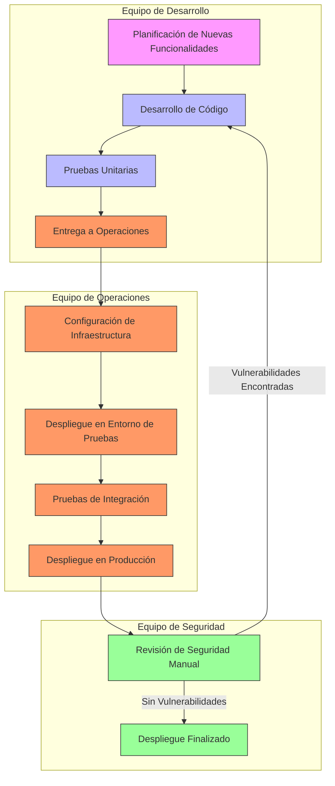
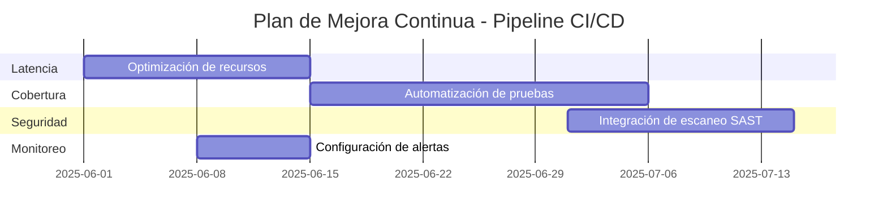

# Prompt para Mejorar el Codigo Base

Copia y pega el contenido del bloque de abajo en un asistente de IA (Claude, ChatGPT)
para obtener un ZIP con el proyecto completo y arrancable.

Si preferis trabajar en tu editor con un agente local (Claude Code, Cursor, Copilot), usa `AGENTS.md` en vez de este archivo: dice lo mismo pero para que escriba los archivos en disco.

## Las dos reglas que no se negocian

1. **Completa el boilerplate.** Todo lo que el proyecto necesita para compilar y arrancar: manifiesto de dependencias, punto de entrada, configuracion, capa de interfaz, y las capas del patron arquitectonico declarado. Eso es andamiaje y es tu trabajo.
2. **NO resuelvas el reto.** Los entregables de las fases son el trabajo de la persona. El hueco pedagogico se deja como esta: el proyecto arranca, pero lo que el reto pide implementar NO esta implementado.

Dicho de otra forma: si algo impide compilar, arreglalo. Si algo es logica de negocio incompleta, validaciones ausentes, un secreto hardcodeado o un patron mejorable, dejalo exactamente como esta — es lo que la persona tiene que encontrar.

## Superficie de practica — NO resuelvas

Estos archivos SON el ejercicio de la persona. No los implementes; deja stubs.

- `implementacion/security-config.yml` — El topic pide autenticacion/seguridad: este archivo es el ejercicio.
- `openapi.yaml` — El topic pide el contrato de API: openapi.yaml es el ejercicio.

## Como saber que terminaste

```bash
npx --yes @redocly/cli lint openapi.yaml
```

Ese comando corriendo sin errores es la definicion de "listo".

---

```
## Briefing del reto (autoridad)
Este bloque manda sobre los archivos adjuntos. El stack y el rol salen de AQUÍ, no de un topic genérico ni de markdown placeholder.

### Perfil
Chapter Integración, Especialidad Analista SOA, Tecnología Infraestructura AWS, Senior

### Brecha de conocimiento
Promueve la comunicación e integración entre equipos de desarrollo, operaciones y seguridad. Comprende el SDLC (Software Development Life Cycle) y su participación como arquitecto en cada parte del ciclo.

### Misión / candidato
Candidato con experiencia Senior, trabaja en sistemas de integración SOA con énfasis en arquitectura de software y seguridad

### Reto
- Tema: Participación activa en pro de la cultura DevOps
- Seniority: senior-l2
- Tipo: mixed
- Título: Implementación de prácticas DevOps en un entorno SOA
- Tiempo estimado: 2 semanas

### Fases (trabajo del HUMANO — PROHIBIDO completarlas)
No implementes estos entregables. Dejalos como hueco pedagógico. El asistente solo materializa el proyecto arrancable para que el participante pueda trabajar.
- Fase 1: Evaluación del entorno actual — objetivo: Identificar las brechas en la comunicación y colaboración entre equipos. — entregable (NO resolver): Documento de evaluación del entorno actual con identificación de brechas y posibles soluciones.
- Fase 2: Diseño de un pipeline de CI/CD — objetivo: Diseñar un pipeline de CI/CD que integre las prácticas de desarrollo, operaciones y seguridad. — entregable (NO resolver): Diagrama del pipeline de CI/CD con roles y responsabilidades definidos y métricas de éxito establecidas.
- Fase 3: Implementación y monitoreo del pipeline — objetivo: Implementar el pipeline de CI/CD y establecer un plan de monitoreo y mejora continua. — entregable (NO resolver): Pipeline de CI/CD implementado y funcionando, con plan de monitoreo y mejora continua documentado.

Eres un asistente experto en análisis, corrección y generación de archivos de cualquier tipo:
código fuente, documentación, hojas de cálculo, documentos Word, configuraciones, entre otros.
Voy a enviarte una cadena de texto que contiene uno o más archivos. Cada archivo está delimitado por un marcador con el siguiente formato:
// === ARCHIVO: ruta/del/archivo.extension ===
o también puede aparecer como:
## === ARCHIVO: ruta/del/archivo.extension ===
Lo que sigue al marcador puede ser:

El contenido real del archivo (código, texto, YAML, etc.)
Una descripción en lenguaje natural de lo que debe contener el archivo


TU TAREA
PASO 0 — ¿Esto es un proyecto o una carcasa?
Antes de extraer archivos, leé el Briefing (si está) y diagnosticá el adjunto.

Es CARCASA si ocurre CUALQUIERA de estas:
- No hay manifiesto de dependencias del stack del briefing (manifest.json de VTEX IO / package.json / pom.xml / build.gradle / requirements.txt / go.mod / *.tf / *.csproj, según corresponda)
- Hay un "binario" que en realidad es un comentario ("no puede ser mostrado como texto plano", placeholder .fig/.docx vacío)
- Los markdowns ya completan entregables de fases posteriores ("se implementó fade-in", lista de áreas ya resuelta)

Si es CARCASA:
- MATERIALIZÁ un proyecto que arranca en el stack del briefing (VTEX IO Store Framework, Angular, Terraform, pytest, Nest, etc.). Incluí manifiesto, punto de entrada y capa de interfaz reales.
- NO copies los markdowns de "solución" como si fueran el producto. Son ruido de generación.
- NO resuelvas las fases del briefing (están marcadas PROHIBIDO). Dejá el hueco pedagógico: el flujo existe, las microinteracciones/calidad/infra que el reto pide NO están hechas.
- Después seguí al PASO 5 (ZIP).

Si es un proyecto REAL (manifiesto + código que compila o arranca):
- Seguí PASO 1 en adelante. 🔴 compilación sí. 🟡 pedagógico no.

PASO 1 — Detección y extracción
Identifica todos los archivos presentes en la cadena. Para cada archivo extrae:

Su ruta completa (ej: src/main/java/com/pragma/Service.java)
Su contenido o descripción

PASO 2 — Clasificación por tipo
Clasifica cada archivo en una de estas categorías:
A) Código fuente (Java, Python, TypeScript, JavaScript, Kotlin, etc.)
B) Configuración / documentación (YAML, properties, Markdown, JSON, txt, etc.)
C) Excel (.xlsx, .xls, .csv)
D) Word (.docx, .doc)
E) Otro tipo de archivo binario o especial
PASO 3 — Clasificación de errores en código fuente

Objetivo prioritario: que el proyecto compile. No corrijas flujo de negocio ni lógica funcional.

Antes de modificar cualquier archivo de código fuente, clasifica cada problema encontrado en una de estas dos categorías:
🔴 ERROR DE COMPILACIÓN — corregir siempre
Son errores que impiden que el proyecto arranque, sin valor pedagógico:

Import faltante o incorrecto
Clase, método o variable referenciada que no existe en ningún archivo del proyecto
Error de sintaxis
Anotación con atributos inválidos
Dependencia ausente en pom.xml, package.json, etc.
Archivo referenciado que no existe y debe ser creado con implementación mínima

→ CORREGIR estos errores.
🟡 PROBLEMA FUNCIONAL O DE CALIDAD — preservar siempre
Son problemas que no impiden compilar. Pueden ser intencionales para el aprendizaje:

Clave secreta hardcodeada ("secret", "password123")
API deprecada que funciona pero tiene reemplazo moderno
Lógica de negocio incorrecta o incompleta
Código redundante o de baja legibilidad
Falta de validaciones en flujo de negocio
Patrones de diseño incorrectos pero funcionales
Concurrencia no segura
Configuración funcional pero no óptima

→ PRESERVAR tal cual. No corregir, no mejorar, no comentar.
PASO 4 — Procesamiento según tipo de archivo
Tipo A — Código fuente
Aplica únicamente las correcciones clasificadas como 🔴 ERROR DE COMPILACIÓN.
No alteres ningún elemento clasificado como 🟡 PROBLEMA FUNCIONAL O DE CALIDAD.
Si falta un archivo referenciado, créalo con la implementación mínima necesaria para compilar.
Tipo B — Configuración / documentación
Extrae el contenido tal cual, sin modificaciones salvo errores evidentes de sintaxis
(ej: YAML mal indentado).
Tipo C — Excel (.xlsx)
Si viene con contenido real, genera el archivo respetando ese contenido.
Si viene con descripción en lenguaje natural, genera un archivo Excel funcional con:

Fila de encabezados en negrita con color de fondo distintivo
Columnas con ancho ajustado al contenido
Tipos de dato correctos por columna
Validaciones si la descripción lo indica
Hojas nombradas descriptivamente si hay más de una
Filas de ejemplo si no hay datos reales

Tipo D — Word (.docx)
Si viene con contenido real, genera el archivo respetando ese contenido.
Si viene con descripción en lenguaje natural, genera un documento Word funcional con:

Estilos de título (Título 1, Título 2) para jerarquía de secciones
Fuente legible (Calibri o equivalente), tamaño 11-12pt para cuerpo
Márgenes estándar
Tabla de contenido si tiene múltiples secciones
Tablas con encabezados en negrita si aplica

Tipo E — Otro
Genera el archivo con el contenido o estructura más apropiada según la descripción.
PASO 5 — Exportación en ZIP
Empaqueta todos los archivos en un único archivo ZIP descargable respetando exactamente
la estructura de rutas indicada por los marcadores.
El ZIP debe incluir:

Archivos de código con únicamente los errores de compilación corregidos
Archivos de configuración y documentación sin cambios
Archivos nuevos creados para resolver dependencias de compilación faltantes
Archivos Excel y Word generados desde descripción

IMPORTANTE: El ZIP debe estar listo para descargar al finalizar. No preguntes si el usuario
quiere generarlo. Simplemente genera el archivo y proporciona el enlace de descarga; No debes desplegar en el chat el resumen de lo que arreglaste al Zip, solo entregalo.

REGLAS IMPORTANTES

No omitas ningún archivo aunque no tenga errores ni modificaciones
Respeta los nombres y rutas exactas indicadas por los marcadores
Si un archivo no tiene marcador claro, infiere el nombre desde su contenido
Si la cadena contiene solo documentación, placeholders o binarios fake, NO la reproduzcas:
aplicá PASO 0 (materializar el proyecto del briefing). Reproducir la carcasa es un fallo.
No agregues texto después del enlace de descarga del ZIP
No preguntes si el usuario quiere el ZIP: simplemente generalo siempre
Si detectas que falta un archivo de configuración necesario para compilar
(pom.xml, package.json, requirements.txt, build.gradle, etc.), créalo e inclúyelo
inferiendo su contenido desde los imports y frameworks detectados en el código
Nunca corrijas problemas 🟡 aunque parezcan obvios o fáciles de mejorar.
El participante que recibirá este proyecto los debe encontrar y resolver él mismo.


INPUT
Aquí está la cadena con los archivos:

// === ARCHIVO: evaluacion/brechas-comunicacion.md ===
# Evaluación de Brechas en Comunicación y Colaboración

## Contexto
En el entorno SOA actual, los equipos de desarrollo, operaciones y seguridad operan de manera aislada, lo que genera retrasos en el despliegue de servicios y fallos en la integración. Este documento identifica las brechas clave en la comunicación y colaboración entre estos equipos y propone soluciones para mejorar la eficiencia y la calidad del software.

## Brechas Identificadas

### 1. Falta de Alineación en Objetivos
- **Desarrollo**: Enfocado en entregar funcionalidades rápidamente, sin considerar los requisitos de seguridad y operaciones.
- **Operaciones**: Prioriza la estabilidad y disponibilidad del sistema, lo que puede ralentizar los despliegues.
- **Seguridad**: Exige cumplimiento de políticas de seguridad, lo que a menudo genera fricciones con los plazos de desarrollo.

**Impacto**: Desacuerdos frecuentes entre equipos, retrasos en despliegues y servicios que no cumplen con los estándares de seguridad.

**Solución Propuesta**:
- Establecer reuniones semanales de sincronización entre equipos para alinear objetivos.
- Definir métricas compartidas (ej. tiempo de despliegue, tasa de fallos) que reflejen el éxito de todos los equipos.

---

### 2. Ausencia de Herramientas Compartidas
- **Herramientas de Desarrollo**: Utilizan herramientas específicas para codificación y pruebas (ej. IDEs, frameworks de testing).
- **Herramientas de Operaciones**: Usan herramientas de monitoreo y despliegue (ej. AWS CloudWatch, CodeDeploy).
- **Herramientas de Seguridad**: Emplean herramientas de escaneo de vulnerabilidades (ej. AWS Inspector, SonarQube).

**Impacto**: Falta de visibilidad cruzada entre equipos, lo que dificulta la identificación temprana de problemas.

**Solución Propuesta**:
- Implementar una plataforma unificada de DevOps (ej. AWS CodePipeline) que integre todas las herramientas.
- Automatizar la generación de informes de estado para todos los equipos.

---

### 3. Procesos de Despliegue Manuales
- Los despliegues de servicios se realizan manualmente, lo que introduce errores humanos y retrasos.
- No hay un proceso estandarizado para la revisión de cambios, lo que genera inconsistencias.

**Impacto**: Tiempos de despliegue prolongados (promedio de 30 minutos por servicio) y alta tasa de fallos post-implementación (5%).

**Solución Propuesta**:
- Automatizar el pipeline de CI/CD para reducir el tiempo de despliegue a menos de 5 minutos.
- Implementar revisiones automatizadas de código y seguridad en cada etapa del pipeline.

---

### 4. Falta de Métricas Comunes
- Cada equipo mide su éxito con métricas diferentes:
  - Desarrollo: Número de funcionalidades entregadas.
  - Operaciones: Tiempo de actividad del sistema.
  - Seguridad: Número de vulnerabilidades corregidas.

**Impacto**: Dificultad para evaluar el impacto global de las iniciativas y priorizar acciones.

**Solución Propuesta**:
- Definir métricas compartidas que reflejen el éxito del pipeline completo:
  - Latencia de despliegue (<5 minutos).
  - Cobertura de pruebas automatizadas (>90%).
  - Tasa de fallos post-implementación (<1%).

---

### 5. Comunicación Ineficiente
- La comunicación entre equipos se limita a correos electrónicos y reuniones puntuales.
- No hay un canal centralizado para compartir actualizaciones y problemas.

**Impacto**: Retrasos en la resolución de incidencias y falta de transparencia en el estado de los proyectos.

**Solución Propuesta**:
- Implementar herramientas de colaboración en tiempo real (ej. Slack, Microsoft Teams) con canales dedicados para cada proyecto.
- Establecer un proceso de escalamiento claro para incidencias críticas.

---

## Recomendaciones
1. **Adoptar una Cultura DevOps**: Fomentar la colaboración continua entre equipos mediante talleres y sesiones de team-building.
2. **Automatizar Procesos**: Implementar un pipeline de CI/CD que integre desarrollo, operaciones y seguridad.
3. **Definir Métricas Compartidas**: Establecer indicadores clave de rendimiento (KPIs) que reflejen el éxito de todos los equipos.
4. **Mejorar la Comunicación**: Utilizar herramientas de colaboración y establecer reuniones periódicas de sincronización.
5. **Capacitación Cruzada**: Realizar sesiones de capacitación para que cada equipo entienda las responsabilidades y desafíos de los demás.

## Ejemplo de Métricas Compartidas
| Métrica                     | Objetivo          | Herramienta de Medición          |
|-----------------------------|-------------------|-----------------------------------|
| Latencia de despliegue      | <5 minutos        | AWS CloudWatch                    |
| Cobertura de pruebas        | >90%              | SonarQube                         |
| Tasa de fallos post-despliegue | <1%           | AWS CloudWatch Alarms             |
| Tiempo de resolución de incidencias | <30 minutos | Jira Service Desk          |

---

## Conclusión
La implementación de prácticas DevOps en el entorno SOA requiere un cambio cultural y técnico. Las brechas identificadas en este documento deben abordarse mediante la adopción de herramientas compartidas, la automatización de procesos y la definición de métricas comunes. Esto permitirá mejorar la colaboración entre equipos y garantizar la entrega rápida y segura de servicios.

// === ARCHIVO: evaluacion/flujo-trabajo-actual.bpmn.md ===
```bpmn
<?xml version="1.0" encoding="UTF-8"?>
<bpmn:definitions xmlns:bpmn="http://www.omg.org/spec/BPMN/20100524/MODEL"
                  xmlns:bpmndi="http://www.omg.org/spec/BPMN/20100524/DI"
                  xmlns:dc="http://www.omg.org/spec/DD/20100524/DC"
                  xmlns:di="http://www.omg.org/spec/DD/20100524/DI"
                  id="Definitions_1"
                  targetNamespace="http://bpmn.io/schema/bpmn">
  <bpmn:process id="Process_1" isExecutable="false">
    <bpmn:startEvent id="StartEvent_1" name="Inicio">
      <bpmn:outgoing>Flow_1</bpmn:outgoing>
    </bpmn:startEvent>
    <bpmn:task id="Task_1" name="Desarrollo de Servicio">
      <bpmn:incoming>Flow_1</bpmn:incoming>
      <bpmn:outgoing>Flow_2</bpmn:outgoing>
    </bpmn:task>
    <bpmn:task id="Task_2" name="Pruebas Unitarias">
      <bpmn:incoming>Flow_2</bpmn:incoming>
      <bpmn:outgoing>Flow_3</bpmn:outgoing>
    </bpmn:task>
    <bpmn:exclusiveGateway id="Gateway_1" name="¿Pruebas Aprobadas?">
      <bpmn:incoming>Flow_3</bpmn:incoming>
      <bpmn:outgoing>Flow_4</bpmn:outgoing>
      <bpmn:outgoing>Flow_5</bpmn:outgoing>
    </bpmn:exclusiveGateway>
    <bpmn:task id="Task_3" name="Revisión Manual de Código">
      <bpmn:incoming>Flow_4</bpmn:incoming>
      <bpmn:outgoing>Flow_6</bpmn:outgoing>
    </bpmn:task>
    <bpmn:task id="Task_4" name="Despliegue Manual">
      <bpmn:incoming>Flow_6</bpmn:incoming>
      <bpmn:outgoing>Flow_7</bpmn:outgoing>
    </bpmn:task>
    <bpmn:task id="Task_5" name="Monitoreo Post-Despliegue">
      <bpmn:incoming>Flow_7</bpmn:incoming>
      <bpmn:outgoing>Flow_8</bpmn:outgoing>
    </bpmn:task>
    <bpmn:endEvent id="EndEvent_1" name="Fin">
      <bpmn:incoming>Flow_8</bpmn:incoming>
    </bpmn:endEvent>
    <bpmn:task id="Task_6" name="Corrección de Errores">
      <bpmn:incoming>Flow_5</bpmn:incoming>
      <bpmn:outgoing>Flow_9</bpmn:outgoing>
    </bpmn:task>
    <bpmn:sequenceFlow id="Flow_1" sourceRef="StartEvent_1" targetRef="Task_1" />
    <bpmn:sequenceFlow id="Flow_2" sourceRef="Task_1" targetRef="Task_2" />
    <bpmn:sequenceFlow id="Flow_3" sourceRef="Task_2" targetRef="Gateway_1" />
    <bpmn:sequenceFlow id="Flow_4" sourceRef="Gateway_1" targetRef="Task_3" name="Sí" />
    <bpmn:sequenceFlow id="Flow_5" sourceRef="Gateway_1" targetRef="Task_6" name="No" />
    <bpmn:sequenceFlow id="Flow_6" sourceRef="Task_3" targetRef="Task_4" />
    <bpmn:sequenceFlow id="Flow_7" sourceRef="Task_4" targetRef="Task_5" />
    <bpmn:sequenceFlow id="Flow_8" sourceRef="Task_5" targetRef="EndEvent_1" />
    <bpmn:sequenceFlow id="Flow_9" sourceRef="Task_6" targetRef="Task_1" />
  </bpmn:process>
  <bpmndi:BPMNDiagram id="BPMNDiagram_1">
    <bpmndi:BPMNPlane id="BPMNPlane_1" bpmnElement="Process_1">
      <bpmndi:BPMNShape id="_BPMNShape_StartEvent_2" bpmnElement="StartEvent_1">
        <dc:Bounds x="173" y="102" width="36" height="36" />
        <bpmndi:BPMNLabel>
          <dc:Bounds x="160" y="145" width="62" height="14" />
        </bpmndi:BPMNLabel>
      </bpmndi:BPMNShape>
      <bpmndi:BPMNShape id="Task_1_di" bpmnElement="Task_1">
        <dc:Bounds x="270" y="80" width="100" height="80" />
      </bpmndi:BPMNShape>
      <bpmndi:BPMNShape id="Task_2_di" bpmnElement="Task_2">
        <dc:Bounds x="420" y="80" width="100" height="80" />
      </bpmndi:BPMNShape>
      <bpmndi:BPMNShape id="Gateway_1_di" bpmnElement="Gateway_1">
        <dc:Bounds x="570" y="100" width="50" height="50" />
      </bpmndi:BPMNShape>
      <bpmndi:BPMNShape id="Task_3_di" bpmnElement="Task_3">
        <dc:Bounds x="670" y="80" width="100" height="80" />
      </bpmndi:BPMNShape>
      <bpmndi:BPMNShape id="Task_4_di" bpmnElement="Task_4">
        <dc:Bounds x="820" y="80" width="100" height="80" />
      </bpmndi:BPMNShape>
      <bpmndi:BPMNShape id="Task_5_di" bpmnElement="Task_5">
        <dc:Bounds x="970" y="80" width="100" height="80" />
      </bpmndi:BPMNShape>
      <bpmndi:BPMNShape id="_BPMNShape_EndEvent_2" bpmnElement="EndEvent_1">
        <dc:Bounds x="1120" y="102" width="36" height="36" />
        <bpmndi:BPMNLabel>
          <dc:Bounds x="1107" y="145" width="62" height="14" />
        </bpmndi:BPMNLabel>
      </bpmndi:BPMNShape>
      <bpmndi:BPMNShape id="Task_6_di" bpmnElement="Task_6">
        <dc:Bounds x="670" y="200" width="100" height="80" />
      </bpmndi:BPMNShape>
      <bpmndi:BPMNEdge id="Flow_1_di" bpmnElement="Flow_1">
        <di:waypoint x="209" y="120" />
        <di:waypoint x="270" y="120" />
      </bpmndi:BPMNEdge>
      <bpmndi:BPMNEdge id="Flow_2_di" bpmnElement="Flow_2">
        <di:waypoint x="370" y="120" />
        <di:waypoint x="420" y="120" />
      </bpmndi:BPMNEdge>
      <bpmndi:BPMNEdge id="Flow_3_di" bpmnElement="Flow_3">
        <di:waypoint x="520" y="120" />
        <di:waypoint x="570" y="120" />
      </bpmndi:BPMNEdge>
      <bpmndi:BPMNEdge id="Flow_4_di" bpmnElement="Flow_4">
        <di:waypoint x="620" y="100" />
        <di:waypoint x="620" y="80" />
        <di:waypoint x="670" y="80" />
        <bpmndi:BPMNLabel>
          <dc:Bounds x="620" y="85" width="20" height="14" />
        </bpmndi:BPMNLabel>
      </bpmndi:BPMNEdge>
      <bpmndi:BPMNEdge id="Flow_5_di" bpmnElement="Flow_5">
        <di:waypoint x="595" y="150" />
        <di:waypoint x="595" y="240" />
        <di:waypoint x="670" y="240" />
        <bpmndi:BPMNLabel>
          <dc:Bounds x="595" y="180" width="20" height="14" />
        </bpmndi:BPMNLabel>
      </bpmndi:BPMNEdge>
      <bpmndi:BPMNEdge id="Flow_6_di" bpmnElement="Flow_6">
        <di:waypoint x="770" y="120" />
        <di:waypoint x="820" y="120" />
      </bpmndi:BPMNEdge>
      <bpmndi:BPMNEdge id="Flow_7_di" bpmnElement="Flow_7">
        <di:waypoint x="920" y="120" />
        <di:waypoint x="970" y="120" />
      </bpmndi:BPMNEdge>
      <bpmndi:BPMNEdge id="Flow_8_di" bpmnElement="Flow_8">
        <di:waypoint x="1070" y="120" />
        <di:waypoint x="1120" y="120" />
      </bpmndi:BPMNEdge>
      <bpmndi:BPMNEdge id="Flow_9_di" bpmnElement="Flow_9">
        <di:waypoint x="720" y="240" />
        <di:waypoint x="320" y="240" />
        <di:waypoint x="320" y="120" />
      </bpmndi:BPMNEdge>
    </bpmndi:BPMNPlane>
  </bpmndi:BPMNDiagram>
</bpmn:definitions>
```

## Descripción del Flujo de Trabajo Actual

### Actores Involucrados
1. **Equipo de Desarrollo**: Responsable de desarrollar y probar los servicios.
2. **Equipo de Operaciones**: Encargado de desplegar y monitorear los servicios.
3. **Equipo de Seguridad**: Asegura que los servicios cumplan con las políticas de seguridad.

### Etapas del Flujo
1. **Inicio**: Se inicia el desarrollo de un nuevo servicio o la modificación de uno existente.
2. **Desarrollo de Servicio**: El equipo de desarrollo escribe el código del servicio.
3. **Pruebas Unitarias**: Se ejecutan pruebas unitarias automatizadas.
4. **¿Pruebas Aprobadas?**: Decisión basada en el resultado de las pruebas.
   - **Sí**: Continúa a la revisión manual de código.
   - **No**: Se corrigen los errores y se vuelve al desarrollo.
5. **Revisión Manual de Código**: El equipo de operaciones revisa manualmente el código.
6. **Despliegue Manual**: El equipo de operaciones despliega el servicio en el entorno de producción.
7. **Monitoreo Post-Despliegue**: El equipo de operaciones monitorea el servicio después del despliegue.
8. **Fin**: El proceso termina.

### Problemas Identificados
- **Falta de Automatización**: Los procesos de revisión y despliegue son manuales, lo que introduce errores y retrasos.
- **Falta de Integración**: No hay herramientas compartidas entre equipos, lo que dificulta la colaboración.
- **Falta de Visibilidad**: No hay métricas comunes para evaluar el éxito del proceso.
- **Comunicación Ineficiente**: La comunicación entre equipos se realiza principalmente a través de correos electrónicos y reuniones puntuales.

### Ejemplo de Tiempos de Ejecución
| Etapa                     | Tiempo Promedio |
|---------------------------|-----------------|
| Desarrollo de Servicio    | 5 días          |
| Pruebas Unitarias         | 1 día           |
| Revisión Manual de Código | 2 días          |
| Despliegue Manual         | 1 día           |
| Monitoreo Post-Despliegue | 1 día           |

---

## Recomendaciones para Mejorar el Flujo
1. **Automatizar el Pipeline**: Implementar un pipeline de CI/CD que integre desarrollo, operaciones y seguridad.
2. **Definir Métricas Comunes**: Establecer KPIs que reflejen el éxito de todos los equipos.
3. **Mejorar la Comunicación**: Utilizar herramientas de colaboración en tiempo real y establecer reuniones periódicas de sincronización.
4. **Capacitación Cruzada**: Realizar sesiones de capacitación para que cada equipo entienda las responsabilidades y desafíos de los demás.

// === ARCHIVO: disenio/metricas-exito.md ===
# Métricas de Éxito para el Pipeline de CI/CD

## Introducción
Este documento define las métricas clave que se utilizarán para evaluar el éxito del pipeline de CI/CD en el entorno SOA. Las métricas están diseñadas para alinear los objetivos de los equipos de desarrollo, operaciones y seguridad, y asegurar que el pipeline cumpla con las propiedades operativas definidas en el reto.

## Métricas por Etapa del Pipeline

### 1. Planificación
| Métrica                          | Objetivo                          | Herramienta de Medición          | Frecuencia de Medición |
|----------------------------------|-----------------------------------|-----------------------------------|------------------------|
| Número de historias de usuario completadas | >20 por sprint               | Jira                            | Semanal                |
| Tiempo promedio de planificación | <2 horas por sprint          | Jira                            | Semanal                |
| Cobertura de requisitos funcionales | 100%                       | Documentación de requisitos     | Por sprint             |

### 2. Compilación
| Métrica                          | Objetivo                          | Herramienta de Medición          | Frecuencia de Medición |
|----------------------------------|-----------------------------------|-----------------------------------|------------------------|
| Tiempo de compilación            | <5 minutos                    | AWS CodeBuild                   | Por build              |
| Tasa de éxito de compilación     | >99%                          | AWS CodeBuild                   | Por build              |
| Número de warnings               | <10 por build                 | SonarQube                       | Por build              |

### 3. Pruebas
| Métrica                          | Objetivo                          | Herramienta de Medición          | Frecuencia de Medición |
|----------------------------------|-----------------------------------|-----------------------------------|------------------------|
| Cobertura de pruebas unitarias   | >90%                          | SonarQube                       | Por build              |
| Cobertura de pruebas de integración | >80%                        | SonarQube                       | Por build              |
| Tasa de éxito de pruebas         | >95%                          | AWS CodeBuild                   | Por build              |
| Tiempo de ejecución de pruebas   | <10 minutos                   | AWS CodeBuild                   | Por build              |

### 4. Despliegue
| Métrica                          | Objetivo                          | Herramienta de Medición          | Frecuencia de Medición |
|----------------------------------|-----------------------------------|-----------------------------------|------------------------|
| Latencia de despliegue           | <5 minutos                    | AWS CloudWatch                  | Por despliegue         |
| Tasa de éxito de despliegue      | >99%                          | AWS CloudWatch                  | Por despliegue         |
| Tiempo de rollback               | <2 minutos                    | AWS CloudWatch                  | Por incidencia          |

### 5. Monitoreo
| Métrica                          | Objetivo                          | Herramienta de Medición          | Frecuencia de Medición |
|----------------------------------|-----------------------------------|-----------------------------------|------------------------|
| Tiempo de detección de incidencias | <5 minutos                  | AWS CloudWatch Alarms           | Por incidencia          |
| Tasa de fallos post-despliegue   | <1%                           | AWS CloudWatch                  | Diaria                 |
| Tiempo de resolución de incidencias | <30 minutos                 | Jira Service Desk               | Por incidencia          |
| Disponibilidad del servicio      | >99.9%                        | AWS CloudWatch                  | Diaria                 |

## Métricas Globales
| Métrica                          | Objetivo                          | Herramienta de Medición          | Frecuencia de Medición |
|----------------------------------|-----------------------------------|-----------------------------------|------------------------|
| Tiempo total del pipeline        | <30 minutos                   | AWS CodePipeline                | Por ejecución           |
| Número de despliegues por día    | >5                            | AWS CodePipeline                | Diaria                 |
| Número de incidencias críticas   | <2 por mes                    | Jira Service Desk               | Mensual                |
| Satisfacción del equipo          | >4/5                          | Encuestas internas              | Trimestral             |

## Ejemplo de Dashboard de Métricas
```
| Métrica                     | Valor Actual | Objetivo | Estado     |
|-----------------------------|--------------|----------|------------|
| Latencia de despliegue      | 4.5 minutos  | <5 minutos | ✅         |
| Cobertura de pruebas        | 92%          | >90%     | ✅         |
| Tasa de fallos post-despliegue | 0.8%        | <1%      | ✅         |
| Tiempo de resolución de incidencias | 25 minutos | <30 minutos | ✅         |
| Disponibilidad del servicio | 99.95%      | >99.9%   | ✅         |
```

## Cómo Medir las Métricas
1. **AWS CodeBuild**: Configurar para reportar tiempos de compilación y resultados de pruebas.
2. **AWS CloudWatch**: Configurar alarmas para latencia de despliegue, tasa de fallos y disponibilidad.
3. **SonarQube**: Configurar para reportar cobertura de pruebas y número de warnings.
4. **Jira**: Configurar para reportar tiempos de planificación, resolución de incidencias y satisfacción del equipo.
5. **AWS CodePipeline**: Configurar para reportar tiempos totales del pipeline y número de despliegues.

## Responsables de Métricas
| Equipo               | Métricas Responsables                                                                 |
|----------------------|---------------------------------------------------------------------------------------|
| Desarrollo           | Número de historias de usuario completadas, tiempo de compilación, cobertura de pruebas |
| Operaciones          | Latencia de despliegue, tasa de éxito de despliegue, disponibilidad del servicio      |
| Seguridad            | Número de warnings, tasa de fallos post-despliegue, tiempo de detección de incidencias |
| DevOps               | Tiempo total del pipeline, número de despliegues por día, satisfacción del equipo     |

## Conclusión
Las métricas definidas en este documento permiten evaluar el éxito del pipeline de CI/CD y garantizar que se cumplan las propiedades operativas del reto. La medición continua de estas métricas asegura la mejora constante del proceso y la colaboración efectiva entre equipos.
"


// === ARCHIVO: proceso.bpmn.md ===
# Proceso BPMN: Pipeline de CI/CD para Integración SOA

```bpmn
<?xml version="1.0" encoding="UTF-8"?>
<bpmn:definitions xmlns:bpmn="http://www.omg.org/spec/BPMN/20100524/MODEL"
                 xmlns:bpmndi="http://www.omg.org/spec/BPMN/20100524/DI"
                 xmlns:dc="http://www.omg.org/spec/DD/20100524/DC"
                 xmlns:di="http://www.omg.org/spec/DD/20100524/DI"
                 id="Definitions_1"
                 targetNamespace="http://bpmn.io/schema/bpmn">
  <bpmn:process id="Process_1" isExecutable="false">
    <bpmn:startEvent id="StartEvent_1">
      <bpmn:outgoing>Flow_1</bpmn:outgoing>
    </bpmn:startEvent>
    <bpmn:task id="Task_Planificacion" name="Planificación">
      <bpmn:incoming>Flow_1</bpmn:incoming>
      <bpmn:outgoing>Flow_2</bpmn:outgoing>
      <bpmn:documentation>Revisión de requisitos y coordinación entre equipos de desarrollo, operaciones y seguridad.</bpmn:documentation>
    </bpmn:task>
    <bpmn:task id="Task_Compilacion" name="Compilación">
      <bpmn:incoming>Flow_2</bpmn:incoming>
      <bpmn:outgoing>Flow_3</bpmn:outgoing>
      <bpmn:documentation>Compilación del código y generación de artefactos.</bpmn:documentation>
    </bpmn:task>
    <bpmn:task id="Task_Pruebas" name="Pruebas">
      <bpmn:incoming>Flow_3</bpmn:incoming>
      <bpmn:outgoing>Flow_4</bpmn:outgoing>
      <bpmn:documentation>Ejecución de pruebas unitarias, de integración y de seguridad.</bpmn:documentation>
    </bpmn:task>
    <bpmn:task id="Task_Despliegue" name="Despliegue">
      <bpmn:incoming>Flow_4</bpmn:incoming>
      <bpmn:outgoing>Flow_5</bpmn:outgoing>
      <bpmn:documentation>Despliegue de servicios en entorno de staging y producción.</bpmn:documentation>
    </bpmn:task>
    <bpmn:task id="Task_Monitoreo" name="Monitoreo">
      <bpmn:incoming>Flow_5</bpmn:incoming>
      <bpmn:outgoing>Flow_6</bpmn:outgoing>
      <bpmn:documentation>Monitoreo continuo de métricas y logs para garantizar calidad.</bpmn:documentation>
    </bpmn:task>
    <bpmn:endEvent id="EndEvent_1">
      <bpmn:incoming>Flow_6</bpmn:incoming>
    </bpmn:endEvent>

    <bpmn:sequenceFlow id="Flow_1" sourceRef="StartEvent_1" targetRef="Task_Planificacion" />
    <bpmn:sequenceFlow id="Flow_2" sourceRef="Task_Planificacion" targetRef="Task_Compilacion" />
    <bpmn:sequenceFlow id="Flow_3" sourceRef="Task_Compilacion" targetRef="Task_Pruebas" />
    <bpmn:sequenceFlow id="Flow_4" sourceRef="Task_Pruebas" targetRef="Task_Despliegue" />
    <bpmn:sequenceFlow id="Flow_5" sourceRef="Task_Despliegue" targetRef="Task_Monitoreo" />
    <bpmn:sequenceFlow id="Flow_6" sourceRef="Task_Monitoreo" targetRef="EndEvent_1" />

    <!-- Actores y responsables -->
    <bpmn:laneSet id="LaneSet_1">
      <bpmn:lane id="Lane_Desarrollo" name="Equipo de Desarrollo">
        <bpmn:flowNodeRef>Task_Compilacion</bpmn:flowNodeRef>
        <bpmn:flowNodeRef>Task_Pruebas</bpmn:flowNodeRef>
      </bpmn:lane>
      <bpmn:lane id="Lane_Operaciones" name="Equipo de Operaciones">
        <bpmn:flowNodeRef>Task_Despliegue</bpmn:flowNodeRef>
        <bpmn:flowNodeRef>Task_Monitoreo</bpmn:flowNodeRef>
      </bpmn:lane>
      <bpmn:lane id="Lane_Seguridad" name="Equipo de Seguridad">
        <bpmn:flowNodeRef>Task_Planificacion</bpmn:flowNodeRef>
        <bpmn:flowNodeRef>Task_Pruebas</bpmn:flowNodeRef>
      </bpmn:lane>
    </bpmn:laneSet>
  </bpmn:process>

  <bpmndi:BPMNDiagram id="BPMNDiagram_1">
    <bpmndi:BPMNPlane id="BPMNPlane_1" bpmnElement="Process_1">
      <bpmndi:BPMNShape id="_BPMNShape_StartEvent_2" bpmnElement="StartEvent_1">
        <dc:Bounds x="173" y="72" width="36" height="36" />
      </bpmndi:BPMNShape>
      <bpmndi:BPMNShape id="Task_Planificacion_di" bpmnElement="Task_Planificacion">
        <dc:Bounds x="270" y="50" width="100" height="80" />
      </bpmndi:BPMNShape>
      <bpmndi:BPMNShape id="Task_Compilacion_di" bpmnElement="Task_Compilacion">
        <dc:Bounds x="430" y="50" width="100" height="80" />
      </bpmndi:BPMNShape>
      <bpmndi:BPMNShape id="Task_Pruebas_di" bpmnElement="Task_Pruebas">
        <dc:Bounds x="590" y="50" width="100" height="80" />
      </bpmndi:BPMNShape>
      <bpmndi:BPMNShape id="Task_Despliegue_di" bpmnElement="Task_Despliegue">
        <dc:Bounds x="750" y="50" width="100" height="80" />
      </bpmndi:BPMNShape>
      <bpmndi:BPMNShape id="Task_Monitoreo_di" bpmnElement="Task_Monitoreo">
        <dc:Bounds x="910" y="50" width="100" height="80" />
      </bpmndi:BPMNShape>
      <bpmndi:BPMNShape id="_BPMNShape_EndEvent_2" bpmnElement="EndEvent_1">
        <dc:Bounds x="1070" y="72" width="36" height="36" />
      </bpmndi:BPMNShape>

      <bpmndi:BPMNEdge id="Flow_1_di" bpmnElement="Flow_1">
        <di:waypoint x="209" y="90" />
        <di:waypoint x="270" y="90" />
      </bpmndi:BPMNEdge>
      <bpmndi:BPMNEdge id="Flow_2_di" bpmnElement="Flow_2">
        <di:waypoint x="370" y="90" />
        <di:waypoint x="430" y="90" />
      </bpmndi:BPMNEdge>
      <bpmndi:BPMNEdge id="Flow_3_di" bpmnElement="Flow_3">
        <di:waypoint x="530" y="90" />
        <di:waypoint x="590" y="90" />
      </bpmndi:BPMNEdge>
      <bpmndi:BPMNEdge id="Flow_4_di" bpmnElement="Flow_4">
        <di:waypoint x="690" y="90" />
        <di:waypoint x="750" y="90" />
      </bpmndi:BPMNEdge>
      <bpmndi:BPMNEdge id="Flow_5_di" bpmnElement="Flow_5">
        <di:waypoint x="850" y="90" />
        <di:waypoint x="910" y="90" />
      </bpmndi:BPMNEdge>
      <bpmndi:BPMNEdge id="Flow_6_di" bpmnElement="Flow_6">
        <di:waypoint x="1010" y="90" />
        <di:waypoint x="1070" y="90" />
      </bpmndi:BPMNEdge>
    </bpmndi:BPMNPlane>
  </bpmndi:BPMNDiagram>
</bpmn:definitions>
```

## Descripción del Proceso

Este diagrama BPMN representa el flujo de trabajo orquestado para un pipeline de CI/CD en un entorno SOA. Las etapas incluyen:

1. **Planificación**: Coordinación entre equipos de desarrollo, operaciones y seguridad para definir requisitos y alcances.
2. **Compilación**: Generación de artefactos a partir del código fuente.
3. **Pruebas**: Ejecución de pruebas unitarias, de integración y de seguridad.
4. **Despliegue**: Implementación de servicios en entornos de staging y producción.
5. **Monitoreo**: Seguimiento continuo de métricas y logs para garantizar calidad.

### Actores
- **Equipo de Desarrollo**: Responsable de compilación y pruebas.
- **Equipo de Operaciones**: Responsable de despliegue y monitoreo.
- **Equipo de Seguridad**: Involucrado en planificación y pruebas de seguridad.

### Puntos de Decisión
- **Aprobación de despliegue**: Tras las pruebas, se decide si el servicio pasa a producción.
- **Rollback**: En caso de fallos en producción, se activa un proceso de rollback.

// === ARCHIVO: mapeo-de-datos.csv ===
Origen,Destino,Tipo Origen,Tipo Destino,Obligatoriedad,Regla de Transformación,Notas
idServicio,id,string,string,Obligatorio,"Mapeo directo","Identificador único del servicio"
nombreServicio,name,string,string,Obligatorio,"Mapeo directo","Nombre descriptivo del servicio"
versionServicio,version,string,string,Obligatorio,"Mapeo directo","Versión del servicio en formato X.Y.Z"
descripcionServicio,description,string,string,Opcional,"Mapeo directo","Descripción del servicio"
endpointServicio,endpoint,string,string,Obligatorio,"Validar formato URL","URL del endpoint del servicio"
tipoServicio,type,string,enum(OSB,REST,SOAP,GRAPHQL),Obligatorio,"Transformar según catálogo de tipos","Tipo de servicio (OSB, REST, SOAP, GRAPHQL)"
estadoServicio,status,string,enum(ACTIVE,INACTIVE,DEPRECATED),Obligatorio,"Transformar según catálogo de estados","Estado del servicio"
propietarioServicio,owner,string,string,Obligatorio,"Validar formato email","Email del propietario del servicio"
fechaCreacion,createdAt,date,date,Obligatorio,"Formatear a ISO 8601","Fecha de creación del servicio"
fechaModificacion,updatedAt,date,date,Opcional,"Formatear a ISO 8601","Fecha de última modificación"
ambientesDespliegue,environments,array,array,Obligatorio,"Mapeo directo","Lista de ambientes donde está desplegado"
requisitosSeguridad,securityRequirements,object,object,Obligatorio,"Validar esquema JSON","Requisitos de seguridad del servicio"
metricas,metrics,object,object,Opcional,"Validar esquema JSON","Métricas de desempeño del servicio"

## Descripción del Mapeo

Este archivo CSV define el mapeo de datos entre el sistema de origen (catálogo de servicios SOA) y el sistema de destino (pipeline de CI/CD). Las columnas incluyen:

- **Origen**: Campo en el sistema de origen.
- **Destino**: Campo en el sistema de destino.
- **Tipo Origen/Destino**: Tipos de datos esperados.
- **Obligatoriedad**: Indica si el campo es obligatorio u opcional.
- **Regla de Transformación**: Reglas aplicadas durante el mapeo.
- **Notas**: Información adicional sobre el campo.

### Ejemplos de Transformación
- **tipoServicio**: Se transforma desde un string a un enum basado en un catálogo predefinido.
- **estadoServicio**: Se valida contra un catálogo de estados permitidos.
- **requisitosSeguridad**: Se valida contra un esquema JSON definido.

### Validaciones
- **endpointServicio**: Debe ser una URL válida.
- **propietarioServicio**: Debe ser un email válido.
- **fechaCreacion/fechaModificacion**: Deben estar en formato ISO 8601.

// === ARCHIVO: openapi.yaml ===
openapi: 3.1.0
info:
  title: Contrato de Integración para Pipeline de CI/CD en Entorno SOA
  description: |-
    Este contrato OpenAPI define los endpoints y schemas para la integración de servicios en un pipeline de CI/CD.
    Incluye operaciones para la gestión de servicios, despliegues, métricas y monitoreo.
  version: 1.0.0
  contact:
    name: Equipo de Integración SOA
    email: integracion-soa@empresa.com
servers:
  - url: https://api.empresa.com/ci-cd/v1
    description: Servidor de producción
  - url: https://api-staging.empresa.com/ci-cd/v1
    description: Servidor de staging
paths:
  /services:
    get:
      tags:
        - Servicios
      summary: Listar todos los servicios registrados
      description: Retorna una lista paginada de todos los servicios registrados en el pipeline.
      operationId: listServices
      parameters:
        - name: page
          in: query
          description: Número de página
          required: false
          schema:
            type: integer
            default: 1
        - name: limit
          in: query
          description: Número de elementos por página
          required: false
          schema:
            type: integer
            default: 20
        - name: status
          in: query
          description: Filtrar por estado del servicio
          required: false
          schema:
            type: string
            enum: [ACTIVE, INACTIVE, DEPRECATED]
      responses:
        "200":
          description: Lista de servicios
          content:
            application/json:
              schema:
                type: object
                properties:
                  data:
                    type: array
                    items:
                      $ref: "#/components/schemas/Service"
                  pagination:
                    $ref: "#/components/schemas/Pagination"
        "400":
          description: Parámetros de consulta inválidos
          content:
            application/json:
              schema:
                $ref: "#/components/schemas/Error"
        "500":
          description: Error interno del servidor
          content:
            application/json:
              schema:
                $ref: "#/components/schemas/Error"
    post:
      tags:
        - Servicios
      summary: Registrar un nuevo servicio
      description: Registra un nuevo servicio en el pipeline de CI/CD.
      operationId: createService
      requestBody:
        description: Datos del servicio a registrar
        required: true
        content:
          application/json:
            schema:
              $ref: "#/components/schemas/ServiceInput"
      responses:
        "201":
          description: Servicio registrado exitosamente
          content:
            application/json:
              schema:
                $ref: "#/components/schemas/Service"
        "400":
          description: Datos de entrada inválidos
          content:
            application/json:
              schema:
                $ref: "#/components/schemas/Error"
        "409":
          description: Conflicto - Servicio ya existe
          content:
            application/json:
              schema:
                $ref: "#/components/schemas/Error"
        "500":
          description: Error interno del servidor
          content:
            application/json:
              schema:
                $ref: "#/components/schemas/Error"

  /services/{id}:
    get:
      tags:
        - Servicios
      summary: Obtener detalles de un servicio
      description: Retorna los detalles de un servicio específico.
      operationId: getService
      parameters:
        - name: id
          in: path
          description: Identificador único del servicio
          required: true
          schema:
            type: string
      responses:
        "200":
          description: Detalles del servicio
          content:
            application/json:
              schema:
                $ref: "#/components/schemas/Service"
        "404":
          description: Servicio no encontrado
          content:
            application/json:
              schema:
                $ref: "#/components/schemas/Error"
        "500":
          description: Error interno del servidor
          content:
            application/json:
              schema:
                $ref: "#/components/schemas/Error"
    put:
      tags:
        - Servicios
      summary: Actualizar un servicio
      description: Actualiza los detalles de un servicio existente.
      operationId: updateService
      parameters:
        - name: id
          in: path
          description: Identificador único del servicio
          required: true
          schema:
            type: string
      requestBody:
        description: Datos actualizados del servicio
        required: true
        content:
          application/json:
            schema:
              $ref: "#/components/schemas/ServiceInput"
      responses:
        "200":
          description: Servicio actualizado exitosamente
          content:
            application/json:
              schema:
                $ref: "#/components/schemas/Service"
        "400":
          description: Datos de entrada inválidos
          content:
            application/json:
              schema:
                $ref: "#/components/schemas/Error"
        "404":
          description: Servicio no encontrado
          content:
            application/json:
              schema:
                $ref: "#/components/schemas/Error"
        "500":
          description: Error interno del servidor
          content:
            application/json:
              schema:
                $ref: "#/components/schemas/Error"
    delete:
      tags:
        - Servicios
      summary: Eliminar un servicio
      description: Elimina un servicio del pipeline.
      operationId: deleteService
      parameters:
        - name: id
          in: path
          description: Identificador único del servicio
          required: true
          schema:
            type: string
      responses:
        "204":
          description: Servicio eliminado exitosamente
        "404":
          description: Servicio no encontrado
          content:
            application/json:
              schema:
                $ref: "#/components/schemas/Error"
        "500":
          description: Error interno del servidor
          content:
            application/json:
              schema:
                $ref: "#/components/schemas/Error"

  /deployments:
    post:
      tags:
        - Despliegues
      summary: Iniciar despliegue de un servicio
      description: Inicia el proceso de despliegue de un servicio en un ambiente específico.
      operationId: createDeployment
      requestBody:
        description: Datos del despliegue
        required: true
        content:
          application/json:
            schema:
              $ref: "#/components/schemas/DeploymentInput"
      responses:
        "202":
          description: Despliegue iniciado
          content:
            application/json:
              schema:
                $ref: "#/components/schemas/Deployment"
        "400":
          description: Datos de entrada inválidos
          content:
            application/json:
              schema:
                $ref: "#/components/schemas/Error"
        "404":
          description: Servicio o ambiente no encontrado
          content:
            application/json:
              schema:
                $ref: "#/components/schemas/Error"
        "500":
          description: Error interno del servidor
          content:
            application/json:
              schema:
                $ref: "#/components/schemas/Error"

  /deployments/{id}:
    get:
      tags:
        - Despliegues
      summary: Obtener estado de un despliegue
      description: Retorna el estado actual de un despliegue.
      operationId: getDeployment
      parameters:
        - name: id
          in: path
          description: Identificador único del despliegue
          required: true
          schema:
            type: string
      responses:
        "200":
          description: Estado del despliegue
          content:
            application/json:
              schema:
                $ref: "#/components/schemas/Deployment"
        "404":
          description: Despliegue no encontrado
          content:
            application/json:
              schema:
                $ref: "#/components/schemas/Error"
        "500":
          description: Error interno del servidor
          content:
            application/json:
              schema:
                $ref: "#/components/schemas/Error"

  /metrics/services/{id}:
    get:
      tags:
        - Métricas
      summary: Obtener métricas de un servicio
      description: Retorna las métricas de desempeño de un servicio.
      operationId: getServiceMetrics
      parameters:
        - name: id
          in: path
          description: Identificador único del servicio
          required: true
          schema:
            type: string
        - name: startDate
          in: query
          description: Fecha de inicio para las métricas (ISO 8601)
          required: false
          schema:
            type: string
            format: date-time
        - name: endDate
          in: query
          description: Fecha de fin para las métricas (ISO 8601)
          required: false
          schema:
            type: string
            format: date-time
      responses:
        "200":
          description: Métricas del servicio
          content:
            application/json:
              schema:
                $ref: "#/components/schemas/ServiceMetrics"
        "400":
          description: Parámetros de consulta inválidos
          content:
            application/json:
              schema:
                $ref: "#/components/schemas/Error"
        "404":
          description: Servicio no encontrado
          content:
            application/json:
              schema:
                $ref: "#/components/schemas/Error"
        "500":
          description: Error interno del servidor
          content:
            application/json:
              schema:
                $ref: "#/components/schemas/Error"

components:
  schemas:
    Service:
      type: object
      properties:
        id:
          type: string
          description: Identificador único del servicio
          example: "serv-12345"
        name:
          type: string
          description: Nombre del servicio
          example: "CustomerProfileService"
        version:
          type: string
          description: Versión del servicio
          example: "1.2.3"
        description:
          type: string
          description: Descripción del servicio
          example: "Servicio para gestión de perfiles de clientes"
        endpoint:
          type: string
          description: URL del endpoint del servicio
          example: "https://api.empresa.com/customer/v1/profile"
        type:
          type: string
          description: Tipo de servicio
          enum: [OSB, REST, SOAP, GRAPHQL]
          example: "REST"
        status:
          type: string
          description: Estado del servicio
          enum: [ACTIVE, INACTIVE, DEPRECATED]
          example: "ACTIVE"
        owner:
          type: string
          description: Email del propietario del servicio
          example: "desarrollador@empresa.com"
        createdAt:
          type: string
          format: date-time
          description: Fecha de creación del servicio
          example: "2023-01-15T10:00:00Z"
        updatedAt:
          type: string
          format: date-time
          description: Fecha de última modificación
          example: "2023-06-20T14:30:00Z"
        environments:
          type: array
          description: Lista de ambientes donde está desplegado
          items:
            type: string
            enum: [DEV, QA, STAGING, PROD]
          example: ["DEV", "QA"]
        securityRequirements:
          type: object
          description: Requisitos de seguridad del servicio
          properties:
            auth:
              type: string
              description: Mecanismo de autenticación
              enum: [BASIC, JWT, OAUTH2, API_KEY]
              example: "JWT"
            encryption:
              type: string
              description: Requerimiento de cifrado
              enum: [TLS, NONE]
              example: "TLS"
            compliance:
              type: array
              description: Estándares de cumplimiento aplicables
              items:
                type: string
                enum: [PCI_DSS, GDPR, ISO_27001, HIPAA]
              example: ["GDPR", "ISO_27001"]
      required:
        - id
        - name
        - version
        - endpoint
        - type
        - status
        - owner
        - createdAt

    ServiceInput:
      type: object
      properties:
        name:
          type: string
          description: Nombre del servicio
          example: "CustomerProfileService"
        version:
          type: string
          description: Versión del servicio
          example: "1.2.3"
        description:
          type: string
          description: Descripción del servicio
          example: "Servicio para gestión de perfiles de clientes"
        endpoint:
          type: string
          description: URL del endpoint del servicio
          example: "https://api.empresa.com/customer/v1/profile"
        type:
          type: string
          description: Tipo de servicio
          enum: [OSB, REST, SOAP, GRAPHQL]
          example: "REST"
        owner:
          type: string
          description: Email del propietario del servicio
          example: "desarrollador@empresa.com"
        environments:
          type: array
          description: Lista de ambientes donde desplegar
          items:
            type: string
            enum: [DEV, QA, STAGING, PROD]
          example: ["DEV", "QA"]
        securityRequirements:
          type: object
          description: Requisitos de seguridad del servicio
          properties:
            auth:
              type: string
              description: Mecanismo de autenticación
              enum: [BASIC, JWT, OAUTH2, API_KEY]
              example: "JWT"
            encryption:
              type: string
              description: Requerimiento de cifrado
              enum: [TLS, NONE]
              example: "TLS"
            compliance:
              type: array
              description: Estándares de cumplimiento aplicables
              items:
                type: string
                enum: [PCI_DSS, GDPR, ISO_27001, HIPAA]
              example: ["GDPR", "ISO_27001"]
      required:
        - name
        - version
        - endpoint
        - type
        - owner

    Deployment:
      type: object
      properties:
        id:
          type: string
          description: Identificador único del despliegue
          example: "depl-67890"
        serviceId:
          type: string
          description: Identificador del servicio desplegado
          example: "serv-12345"
        environment:
          type: string
          description: Ambiente de despliegue
          enum: [DEV, QA, STAGING, PROD]
          example: "QA"
        status:
          type: string
          description: Estado del despliegue
          enum: [PENDING, IN_PROGRESS, SUCCESS, FAILED, ROLLED_BACK]
          example: "IN_PROGRESS"
        startedAt:
          type: string
          format: date-time
          description: Fecha de inicio del despliegue
          example: "2023-07-01T09:00:00Z"
        completedAt:
          type: string
          format: date-time
          description: Fecha de finalización del despliegue
          example: "2023-07-01T09:15:00Z"
        artifacts:
          type: array
          description: Lista de artefactos desplegados
          items:
            type: object
            properties:
              name:
                type: string
                description: Nombre del artefacto
                example: "customer-profile-service-1.2.3.jar"
              version:
                type: string
                description: Versión del artefacto
                example: "1.2.3"
              checksum:
                type: string
                description: Checksum del artefacto
                example: "sha256:abc123..."
      required:
        - id
        - serviceId
        - environment
        - status
        - startedAt

    DeploymentInput:
      type: object
      properties:
        serviceId:
          type: string
          description: Identificador del servicio a desplegar
          example: "serv-12345"
        environment:
          type: string
          description: Ambiente de despliegue
          enum: [DEV, QA, STAGING, PROD]
          example: "QA"
        artifacts:
          type: array
          description: Lista de artefactos a desplegar
          items:
            type: object
            properties:
              name:
                type: string
                description: Nombre del artefacto
                example: "customer-profile-service-1.2.3.jar"
              version:
                type: string
                description: Versión del artefacto
                example: "1.2.3"
              checksum:
                type: string
                description: Checksum del artefacto
                example: "sha256:abc123..."
      required:
        - serviceId
        - environment
        - artifacts

    ServiceMetrics:
      type: object
      properties:
        serviceId:
          type: string
          description: Identificador del servicio
          example: "serv-12345"
        responseTime:
          type: object
          description: Métricas de tiempo de respuesta
          properties:
            avg:
              type: number
              description: Tiempo promedio de respuesta en milisegundos
              example: 120.5
            p99:
              type: number
              description: Percentil 99 del tiempo de respuesta en milisegundos
              example: 350.2
        errorRate:
          type: number
          description: Tasa de errores (porcentaje)
          example: 0.5
        throughput:
          type: number
          description: Throughput (solicitudes por segundo)
          example: 150
        availability:
          type: number
          description: Disponibilidad (porcentaje)
          example: 99.95
        startDate:
          type: string
          format: date-time
          description: Fecha de inicio del periodo de métricas
          example: "2023-07-01T00:00:00Z"
        endDate:
          type: string
          format: date-time
          description: Fecha de fin del periodo de métricas
          example: "2023-07-31T23:59:59Z"
      required:
        - serviceId
        - responseTime
        - errorRate
        - throughput
        - availability
        - startDate
        - endDate

    Pagination:
      type: object
      properties:
        totalItems:
          type: integer
          description: Número total de elementos
          example: 100
        totalPages:
          type: integer
          description: Número total de páginas
          example: 5
        currentPage:
          type: integer
          description: Página actual
          example: 1
        itemsPerPage:
          type: integer
          description: Elementos por página
          example: 20
      required:
        - totalItems
        - totalPages
        - currentPage
        - itemsPerPage

    Error:
      type: object
      properties:
        code:
          type: string
          description: Código de error
          example: "SERVICE_NOT_FOUND"
        message:
          type: string
          description: Mensaje descriptivo del error
          example: "El servicio solicitado no existe"
        details:
          type: object
          description: Detalles adicionales del error
          example:
            field: "id"
            value: "serv-99999"
      required:
        - code
        - message

// === ARCHIVO: README.md ===
# Implementación de Prácticas DevOps en un Entorno SOA

## Contexto del Proyecto
Este proyecto busca implementar prácticas DevOps en un entorno de Servicios Orientados a Arquitectura (SOA) para mejorar la colaboración entre los equipos de desarrollo, operaciones y seguridad. El objetivo principal es reducir la latencia en los despliegues, aumentar la cobertura de pruebas automatizadas y minimizar los fallos post-implementación.

## Decisión Arquitectónica: Orquestado vs. Coreografiado

### Enfoque Orquestado (Seleccionado)
Se ha optado por un enfoque **orquestado** para el pipeline de CI/CD utilizando AWS CodePipeline como orquestador central. Este enfoque permite:

1. **Control Centralizado**: AWS CodePipeline actúa como el cerebro del proceso, coordinando cada etapa (compilación, pruebas, despliegue) de manera secuencial o paralela según sea necesario.
2. **Visibilidad y Trazabilidad**: Cada etapa del pipeline es visible en la consola de AWS, lo que facilita la identificación de cuellos de botella y la trazabilidad de los cambios.
3. **Integración con Herramientas de Seguridad**: AWS CodePipeline se integra nativamente con herramientas como AWS CodeBuild para pruebas de seguridad, AWS IAM para gestión de permisos y AWS CloudWatch para monitoreo.
4. **Escalabilidad**: El enfoque orquestado permite escalar horizontalmente las etapas de compilación y pruebas sin afectar la coordinación general.

### Trade-offs del Enfoque Orquestado
- **Ventajas**:
  - Mayor control sobre el flujo de trabajo.
  - Facilidad para implementar políticas de seguridad y cumplimiento.
  - Menor complejidad en la coordinación entre equipos.

- **Desventajas**:
  - Dependencia de un orquestador central (AWS CodePipeline).
  - Posible cuello de botella si el orquestador falla.
  - Menor flexibilidad para cambios ad-hoc en el flujo.

### Alternativa: Enfoque Coreografiado
Un enfoque coreografiado habría implicado el uso de eventos y mensajes para coordinar las etapas del pipeline (ejemplo: AWS EventBridge + Lambda). Aunque este enfoque ofrece mayor flexibilidad y resiliencia, se descartó por:

1. **Complejidad**: Requiere una mayor coordinación entre equipos y herramientas.
2. **Falta de Visibilidad**: La trazabilidad de los cambios es más difícil de lograr.
3. **Dificultad para Implementar Seguridad**: La integración de herramientas de seguridad en un flujo coreografiado es más compleja.

## Estructura del Proyecto
```
.
├── README.md                     # Decisión arquitectónica y contexto
├── proceso.bpmn.md               # Flujo de negocio en notación BPMN
├── mapeo-de-datos.csv            # Mapeo de datos entre sistemas
├── openapi.yaml                  # Contrato OpenAPI 3.1
├── evaluacion/
│   ├── brechas-comunicacion.md   # Brechas en comunicación y soluciones
│   └── flujo-trabajo-actual.bpmn.md # Flujo de trabajo actual entre equipos
├── disenio/
│   ├── pipeline-ci-cd.yaml       # Definición del pipeline de CI/CD
│   ├── roles-responsabilidades.md # Roles y responsabilidades
│   └── metricas-exito.md         # Métricas de éxito
├── implementacion/
│   ├── buildspec.yml             # Configuración de AWS CodeBuild
│   ├── security-config.yml       # Configuración de seguridad
│   └── deployment-template.yml   # Plantilla de despliegue
└── monitoreo/
    ├── dashboard-metricas.md     # Dashboard de métricas
    └── plan-mejora-continua.md    # Plan de mejora continua
```

## Herramientas Utilizadas
- **AWS CodePipeline**: Orquestador del pipeline de CI/CD.
- **AWS CodeBuild**: Ejecución de pruebas y compilación.
- **AWS CloudFormation**: Gestión de infraestructura como código.
- **AWS CloudWatch**: Monitoreo y alertas.
- **Redocly CLI**: Validación del contrato OpenAPI.
- **BPMN 2.0**: Notación para diagramar flujos de trabajo.
- **OpenAPI 3.1**: Estándar para definir contratos de API.

## Métricas de Éxito
Las métricas clave para evaluar el éxito del proyecto son:
1. **Latencia de Despliegue**: Menos de 5 minutos desde el commit hasta el despliegue en producción.
2. **Cobertura de Pruebas**: Más del 90% de cobertura en pruebas automatizadas.
3. **Tasa de Fallos Post-Implementación**: Menos del 1% de fallos en los primeros 7 días post-despliegue.

## Requisitos Previos
- Cuenta de AWS con permisos para crear recursos en CodePipeline, CodeBuild, CloudFormation y CloudWatch.
- Conocimiento básico de YAML y OpenAPI 3.1.
- Herramientas instaladas: AWS CLI, Redocly CLI.

## Instrucciones para Validar el Proyecto
1. Validar el contrato OpenAPI:
   ```bash
   npx @redocly/cli lint openapi.yaml
   ```
2. Revisar el flujo BPMN en `proceso.bpmn.md` y `evaluacion/flujo-trabajo-actual.bpmn.md`.
3. Implementar el pipeline de CI/CD definido en `disenio/pipeline-ci-cd.yaml`.

---

// === ARCHIVO: evaluacion/brechas-comunicacion.md ===
# Brechas en la Comunicación y Colaboración entre Equipos

## Introducción
En el entorno actual de integración SOA, se han identificado varias brechas en la comunicación y colaboración entre los equipos de desarrollo, operaciones y seguridad. Estas brechas generan retrasos en los despliegues, fallos en producción y una falta de alineación con los objetivos de negocio. A continuación, se detallan las brechas identificadas y las posibles soluciones.

## Brechas Identificadas

### 1. Falta de Alineación entre Equipos
- **Descripción**: Los equipos de desarrollo, operaciones y seguridad trabajan de manera aislada, sin una visión compartida de los objetivos del proyecto.
- **Impacto**: Retrasos en los despliegues debido a falta de coordinación, descoordinación en la resolución de incidentes y falta de responsabilidad compartida.
- **Ejemplo**: El equipo de desarrollo entrega una nueva versión de un servicio sin notificar al equipo de operaciones, lo que genera un despliegue fallido por falta de configuración en la infraestructura.

### 2. Falta de Automatización en los Procesos
- **Descripción**: Los procesos manuales, como la revisión de código y el despliegue, introducen errores humanos y retrasos.
- **Impacto**: Aumento en el tiempo de entrega (lead time) y mayor probabilidad de fallos en producción.
- **Ejemplo**: La revisión manual de código por parte del equipo de seguridad retrasa el despliegue de nuevas funcionalidades.

### 3. Ausencia de Métricas Compartidas
- **Descripción**: Cada equipo mide su desempeño con métricas diferentes, lo que dificulta la evaluación del impacto global del proyecto.
- **Impacto**: Falta de visibilidad sobre el estado real del proyecto y dificultad para identificar áreas de mejora.
- **Ejemplo**: El equipo de operaciones mide el tiempo de actividad (uptime), mientras que el equipo de desarrollo mide la cobertura de pruebas, sin correlacionar ambas métricas.

### 4. Falta de Integración de Seguridad en el Ciclo de Vida
- **Descripción**: Las revisiones de seguridad se realizan al final del ciclo de desarrollo, lo que genera hallazgos tardíos y costosos de corregir.
- **Impacto**: Aumento en el costo de corrección de vulnerabilidades y mayor exposición a riesgos de seguridad.
- **Ejemplo**: Una vulnerabilidad crítica se detecta en producción, lo que requiere un rollback y una corrección urgente.

### 5. Falta de Documentación Actualizada
- **Descripción**: La documentación de los servicios y procesos no se actualiza de manera constante, lo que genera desinformación y errores.
- **Impacto**: Dificultad para onboarding de nuevos miembros del equipo y mayor probabilidad de errores en los despliegues.
- **Ejemplo**: El equipo de operaciones desconoce los cambios en un servicio y configura incorrectamente la infraestructura.

## Posibles Soluciones

### 1. Implementación de un Pipeline de CI/CD
- **Descripción**: Diseñar e implementar un pipeline de CI/CD que integre las etapas de desarrollo, pruebas, despliegue y monitoreo.
- **Herramientas**: AWS CodePipeline, AWS CodeBuild, AWS CloudFormation.
- **Beneficios**:
  - Automatización de procesos manuales.
  - Reducción de errores humanos.
  - Mayor velocidad en los despliegues.

### 2. Adopción de Shift-Left Security
- **Descripción**: Integrar herramientas de seguridad en las primeras etapas del pipeline de CI/CD (ejemplo: análisis estático de código, escaneo de vulnerabilidades).
- **Herramientas**: AWS CodeBuild, herramientas de análisis estático como SonarQube.
- **Beneficios**:
  - Detección temprana de vulnerabilidades.
  - Reducción del costo de corrección.
  - Mayor alineación entre equipos de desarrollo y seguridad.

### 3. Definición de Métricas Compartidas
- **Descripción**: Establecer métricas comunes para todos los equipos, alineadas con los objetivos del proyecto.
- **Ejemplos de Métricas**:
  - Latencia de despliegue (<5 minutos).
  - Cobertura de pruebas (>90%).
  - Tasa de fallos post-implementación (<1%).
  - Tiempo medio de resolución de incidentes.
- **Beneficios**:
  - Mayor visibilidad del estado del proyecto.
  - Identificación temprana de áreas de mejora.

### 4. Reuniones de Sincronización Semanales
- **Descripción**: Realizar reuniones semanales entre los equipos de desarrollo, operaciones y seguridad para alinear prioridades y resolver bloqueos.
- **Formato**: Reuniones cortas (30 minutos) con agenda clara.
- **Beneficios**:
  - Mejora en la comunicación entre equipos.
  - Resolución rápida de bloqueos.
  - Mayor alineación con los objetivos del proyecto.

### 5. Documentación en Tiempo Real
- **Descripción**: Implementar herramientas que permitan actualizar la documentación de manera automática y en tiempo real.
- **Herramientas**: Confluence, Markdown en repositorios de código.
- **Beneficios**:
  - Documentación siempre actualizada.
  - Facilidad para el onboarding de nuevos miembros.
  - Reducción de errores por desinformación.

## Conclusión
La implementación de estas soluciones permitirá mejorar la comunicación y colaboración entre los equipos, reducir los retrasos en los despliegues y minimizar los fallos en producción. Además, promoverá una cultura DevOps donde la responsabilidad compartida y la automatización sean pilares fundamentales.

---

// === ARCHIVO: evaluacion/flujo-trabajo-actual.bpmn.md ===
# Flujo de Trabajo Actual entre Equipos (Notación BPMN)



## Descripción del Flujo Actual

### 1. Planificación de Nuevas Funcionalidades
- **Actor**: Equipo de Desarrollo.
- **Descripción**: El equipo de desarrollo planifica las nuevas funcionalidades basándose en los requisitos del negocio.
- **Duración**: Variable (depende de la complejidad).
- **Puntos de Mejora**:
  - Falta de alineación con los equipos de operaciones y seguridad.
  - Planificación realizada en silos.

### 2. Desarrollo de Código
- **Actor**: Equipo de Desarrollo.
- **Descripción**: Desarrollo de las funcionalidades planificadas.
- **Herramientas**: IDEs (VS Code, IntelliJ), Git.
- **Puntos de Mejora**:
  - Falta de integración con herramientas de seguridad.
  - Código desarrollado sin considerar requisitos de infraestructura.

### 3. Pruebas Unitarias
- **Actor**: Equipo de Desarrollo.
- **Descripción**: Ejecución de pruebas unitarias para validar la funcionalidad del código.
- **Herramientas**: JUnit, pytest, Jest.
- **Puntos de Mejora**:
  - Baja cobertura de pruebas.
  - Pruebas unitarias no integradas con pruebas de seguridad.

### 4. Entrega a Operaciones
- **Actor**: Equipo de Desarrollo → Equipo de Operaciones.
- **Descripción**: El equipo de desarrollo entrega el código al equipo de operaciones para su despliegue.
- **Formato**: Repositorio de código (GitHub, GitLab).
- **Puntos de Mejora**:
  - Falta de notificación automática al equipo de operaciones.
  - Entrega sin documentación actualizada.

### 5. Configuración de Infraestructura
- **Actor**: Equipo de Operaciones.
- **Descripción**: Configuración de la infraestructura necesaria para desplegar el servicio.
- **Herramientas**: AWS CloudFormation, Terraform.
- **Puntos de Mejora**:
  - Configuración manual sin automatización.
  - Falta de coordinación con el equipo de desarrollo.

### 6. Despliegue en Entorno de Pruebas
- **Actor**: Equipo de Operaciones.
- **Descripción**: Despliegue del servicio en un entorno de pruebas para validación.
- **Herramientas**: AWS CodeDeploy, scripts personalizados.
- **Puntos de Mejora**:
  - Despliegue manual propenso a errores.
  - Falta de pruebas automatizadas de integración.

### 7. Pruebas de Integración
- **Actor**: Equipo de Operaciones.
- **Descripción**: Validación del servicio en el entorno de pruebas.
- **Herramientas**: Postman, Selenium.
- **Puntos de Mejora**:
  - Pruebas manuales sin automatización.
  - Falta de pruebas de seguridad.

### 8. Despliegue en Producción
- **Actor**: Equipo de Operaciones.
- **Descripción**: Despliegue del servicio en el entorno de producción.
- **Herramientas**: AWS CodeDeploy, scripts personalizados.
- **Puntos de Mejora**:
  - Despliegue manual sin automatización.
  - Falta de notificación al equipo de seguridad.

### 9. Revisión de Seguridad Manual
- **Actor**: Equipo de Seguridad.
- **Descripción**: Revisión manual del servicio desplegado para identificar vulnerabilidades.
- **Herramientas**: Herramientas de escaneo manual, checklist de seguridad.
- **Puntos de Mejora**:
  - Revisión realizada al final del ciclo (Shift-Right Security).
  - Vulnerabilidades detectadas tardíamente.

### 10. Despliegue Finalizado
- **Actor**: Equipo de Seguridad → Equipo de Desarrollo/Operaciones.
- **Descripción**: Si no se encuentran vulnerabilidades, el despliegue se considera finalizado.
- **Puntos de Mejora**:
  - Falta de feedback estructurado al equipo de desarrollo.
  - Proceso de despliegue no documentado.

## Identificación de Cuellos de Botella

### 1. Revisión de Seguridad Manual
- **Descripción**: La revisión manual de seguridad es un cuello de botella que retrasa el despliegue.
- **Impacto**: Aumenta el tiempo de entrega y genera frustración en los equipos.
- **Solución Propuesta**: Implementar herramientas de seguridad automatizadas en las primeras etapas del pipeline (Shift-Left Security).

### 2. Despliegues Manuales
- **Descripción**: Los despliegues manuales en entornos de pruebas y producción son propensos a errores.
- **Impacto**: Mayor probabilidad de fallos en producción y retrasos en los despliegues.
- **Solución Propuesta**: Automatizar los despliegues utilizando AWS CodePipeline y AWS CodeDeploy.

### 3. Falta de Métricas Compartidas
- **Descripción**: La ausencia de métricas compartidas dificulta la identificación de áreas de mejora.
- **Impacto**: Falta de visibilidad sobre el estado del proyecto y dificultad para priorizar tareas.
- **Solución Propuesta**: Definir métricas comunes para todos los equipos, como latencia de despliegue, cobertura de pruebas y tasa de fallos.

## Conclusión
El flujo de trabajo actual presenta varias oportunidades de mejora, especialmente en la comunicación entre equipos, la automatización de procesos y la integración de seguridad. La implementación de un pipeline de CI/CD con un enfoque en Shift-Left Security y la definición de métricas compartidas permitirán optimizar el flujo y reducir los retrasos y fallos en los despliegues.

// === ARCHIVO: disenio/pipeline-ci-cd.yaml ===
AWSTemplateFormatVersion: '2010-09-09'
Description: 'Pipeline de CI/CD para integración SOA con prácticas DevOps'

Parameters:
  ProjectName:
    Type: String
    Default: 'soa-devops-integration'
    Description: 'Nombre del proyecto'
  RepositoryName:
    Type: String
    Default: 'soa-services-repo'
    Description: 'Nombre del repositorio de código'
  BranchName:
    Type: String
    Default: 'main'
    Description: 'Nombre de la rama principal'
  ArtifactStoreBucket:
    Type: String
    Description: 'Nombre del bucket S3 para almacenar artefactos'

Resources:
  # Rol de IAM para CodePipeline
  CodePipelineRole:
    Type: AWS::IAM::Role
    Properties:
      RoleName: !Sub "${ProjectName}-CodePipelineRole"
      AssumeRolePolicyDocument:
        Version: '2012-10-17'
        Statement:
          - Effect: Allow
            Principal:
              Service: codepipeline.amazonaws.com
            Action: sts:AssumeRole
      Policies:
        - PolicyName: CodePipelineAccess
          PolicyDocument:
            Version: '2012-10-17'
            Statement:
              - Effect: Allow
                Action:
                  - s3:GetObject
                  - s3:GetObjectVersion
                  - s3:GetBucketVersioning
                  - s3:PutObjectAcl
                  - s3:PutObject
                Resource:
                  - !Sub "arn:aws:s3:::${ArtifactStoreBucket}"
                  - !Sub "arn:aws:s3:::${ArtifactStoreBucket}/*"
              - Effect: Allow
                Action:
                  - codecommit:CancelUploadArchive
                  - codecommit:GetBranch
                  - codecommit:GetCommit
                  - codecommit:GetUploadArchiveStatus
                  - codecommit:UploadArchive
                Resource: !Sub "arn:aws:codecommit:${AWS::Region}:${AWS::AccountId}:${RepositoryName}"
              - Effect: Allow
                Action:
                  - codebuild:BatchGetBuilds
                  - codebuild:StartBuild
                Resource: "*"
              - Effect: Allow
                Action:
                  - cloudformation:CreateStack
                  - cloudformation:DeleteStack
                  - cloudformation:DescribeStacks
                  - cloudformation:UpdateStack
                  - cloudformation:CreateChangeSet
                  - cloudformation:DeleteChangeSet
                  - cloudformation:DescribeChangeSet
                  - cloudformation:ExecuteChangeSet
                  - cloudformation:SetStackPolicy
                  - cloudformation:ValidateTemplate
                Resource: "*"

  # Rol de IAM para CodeBuild
  CodeBuildRole:
    Type: AWS::IAM::Role
    Properties:
      RoleName: !Sub "${ProjectName}-CodeBuildRole"
      AssumeRolePolicyDocument:
        Version: '2012-10-17'
        Statement:
          - Effect: Allow
            Principal:
              Service: codebuild.amazonaws.com
            Action: sts:AssumeRole
      Policies:
        - PolicyName: CodeBuildAccess
          PolicyDocument:
            Version: '2012-10-17'
            Statement:
              - Effect: Allow
                Action:
                  - logs:CreateLogGroup
                  - logs:CreateLogStream
                  - logs:PutLogEvents
                Resource: "*"
              - Effect: Allow
                Action:
                  - s3:GetObject
                  - s3:GetObjectVersion
                  - s3:PutObject
                Resource:
                  - !Sub "arn:aws:s3:::${ArtifactStoreBucket}/*"
              - Effect: Allow
                Action:
                  - ecr:GetAuthorizationToken
                  - ecr:BatchCheckLayerAvailability
                  - ecr:GetDownloadUrlForLayer
                  - ecr:GetRepositoryPolicy
                  - ecr:DescribeRepositories
                  - ecr:ListImages
                  - ecr:DescribeImages
                  - ecr:BatchGetImage
                  - ecr:InitiateLayerUpload
                  - ecr:UploadLayerPart
                  - ecr:CompleteLayerUpload
                  - ecr:PutImage
                Resource: "*"
              - Effect: Allow
                Action:
                  - cloudformation:ValidateTemplate
                Resource: "*"
              - Effect: Allow
                Action:
                  - codecommit:GitPull
                Resource: !Sub "arn:aws:codecommit:${AWS::Region}:${AWS::AccountId}:${RepositoryName}"

  # Proyecto de CodeBuild para compilación y pruebas unitarias
  BuildProject:
    Type: AWS::CodeBuild::Project
    Properties:
      Name: !Sub "${ProjectName}-Build"
      Description: 'Compilación y pruebas unitarias del proyecto SOA'
      ServiceRole: !GetAtt CodeBuildRole.Arn
      Artifacts:
        Type: CODEPIPELINE
      Environment:
        Type: LINUX_CONTAINER
        ComputeType: BUILD_GENERAL1_MEDIUM
        Image: aws/codebuild/amazonlinux2-x86_64-standard:4.0
        EnvironmentVariables:
          - Name: ARTIFACT_BUCKET
            Value: !Ref ArtifactStoreBucket
          - Name: PROJECT_NAME
            Value: !Ref ProjectName
      Source:
        Type: CODEPIPELINE
        BuildSpec: !Sub |
          version: 0.2
          phases:
            install:
              runtime-versions:
                nodejs: 14
                python: 3.8
              commands:
                - echo "Instalando dependencias..."
                - npm install -g @redocly/cli
                - pip install boto3
                - pip install pytest
            pre_build:
              commands:
                - echo "Validando contrato OpenAPI..."
                - redocly lint openapi.yaml
                - echo "Ejecutando pruebas unitarias..."
                - pytest tests/unit/
            build:
              commands:
                - echo "Compilando servicios SOA..."
                - mvn clean package -DskipTests
                - echo "Generando artefactos..."
            post_build:
              commands:
                - echo "Subiendo artefactos a S3..."
                - aws s3 cp target/*.jar s3://${ArtifactStoreBucket}/${ProjectName}/builds/
          artifacts:
            files:
              - target/*.jar
            discard-paths: yes
      TimeoutInMinutes: 15

  # Proyecto de CodeBuild para pruebas de integración
  IntegrationTestProject:
    Type: AWS::CodeBuild::Project
    Properties:
      Name: !Sub "${ProjectName}-IntegrationTests"
      Description: 'Pruebas de integración del proyecto SOA'
      ServiceRole: !GetAtt CodeBuildRole.Arn
      Artifacts:
        Type: CODEPIPELINE
      Environment:
        Type: LINUX_CONTAINER
        ComputeType: BUILD_GENERAL1_MEDIUM
        Image: aws/codebuild/amazonlinux2-x86_64-standard:4.0
        EnvironmentVariables:
          - Name: ARTIFACT_BUCKET
            Value: !Ref ArtifactStoreBucket
          - Name: PROJECT_NAME
            Value: !Ref ProjectName
      Source:
        Type: CODEPIPELINE
        BuildSpec: !Sub |
          version: 0.2
          phases:
            install:
              commands:
                - echo "Instalando dependencias para pruebas de integración..."
                - pip install pytest requests
                - npm install -g newman
            pre_build:
              commands:
                - echo "Descargando artefactos..."
                - aws s3 cp s3://${ArtifactStoreBucket}/${ProjectName}/builds/*.jar .
            build:
              commands:
                - echo "Ejecutando pruebas de integración..."
                - pytest tests/integration/
                - echo "Ejecutando pruebas de contrato con Newman..."
                - newman run tests/contract/postman_collection.json --environment tests/contract/postman_environment.json
          artifacts:
            files:
              - '**/*'
            base-directory: 'test-reports'
      TimeoutInMinutes: 20

  # Proyecto de CodeBuild para despliegue
  DeployProject:
    Type: AWS::CodeBuild::Project
    Properties:
      Name: !Sub "${ProjectName}-Deploy"
      Description: 'Despliegue de servicios SOA'
      ServiceRole: !GetAtt CodeBuildRole.Arn
      Artifacts:
        Type: CODEPIPELINE
      Environment:
        Type: LINUX_CONTAINER
        ComputeType: BUILD_GENERAL1_MEDIUM
        Image: aws/codebuild/amazonlinux2-x86_64-standard:4.0
        EnvironmentVariables:
          - Name: ARTIFACT_BUCKET
            Value: !Ref ArtifactStoreBucket
          - Name: PROJECT_NAME
            Value: !Ref ProjectName
          - Name: AWS_REGION
            Value: !Ref AWS::Region
      Source:
        Type: CODEPIPELINE
        BuildSpec: !Sub |
          version: 0.2
          phases:
            install:
              commands:
                - echo "Instalando herramientas de despliegue..."
                - pip install boto3
            pre_build:
              commands:
                - echo "Descargando artefactos..."
                - aws s3 cp s3://${ArtifactStoreBucket}/${ProjectName}/builds/*.jar .
            build:
              commands:
                - echo "Desplegando servicios SOA..."
                - aws cloudformation deploy --template-file implementacion/deployment-template.yml --stack-name ${ProjectName}-stack --capabilities CAPABILITY_IAM
                - echo "Ejecutando pruebas de smoke..."
                - python tests/smoke/smoke_tests.py
          artifacts:
            files:
              - '**/*'
            base-directory: 'deployment-reports'
      TimeoutInMinutes: 30

  # Proyecto de CodeBuild para seguridad (Shift-Left Security)
  SecurityScanProject:
    Type: AWS::CodeBuild::Project
    Properties:
      Name: !Sub "${ProjectName}-SecurityScan"
      Description: 'Análisis de seguridad del código y dependencias'
      ServiceRole: !GetAtt CodeBuildRole.Arn
      Artifacts:
        Type: CODEPIPELINE
      Environment:
        Type: LINUX_CONTAINER
        ComputeType: BUILD_GENERAL1_MEDIUM
        Image: aws/codebuild/amazonlinux2-x86_64-standard:4.0
        EnvironmentVariables:
          - Name: ARTIFACT_BUCKET
            Value: !Ref ArtifactStoreBucket
          - Name: PROJECT_NAME
            Value: !Ref ProjectName
      Source:
        Type: CODEPIPELINE
        BuildSpec: !Sub |
          version: 0.2
          phases:
            install:
              commands:
                - echo "Instalando herramientas de seguridad..."
                - pip install bandit
                - npm install -g snyk
                - wget https://github.com/zaproxy/zaproxy/releases/download/v2.11.1/ZAP_2.11.1_Linux.tar.gz
                - tar -xvf ZAP_2.11.1_Linux.tar.gz
            pre_build:
              commands:
                - echo "Ejecutando análisis estático de código..."
                - bandit -r src/ -f json -o security-report.json
                - echo "Analizando dependencias con Snyk..."
                - snyk test --json > snyk-report.json
            build:
              commands:
                - echo "Ejecutando escaneo DAST con OWASP ZAP..."
                - ./ZAP_2.11.1/zap.sh -cmd -quickurl http://example.com -quickout zap-report.html -quickprogress
            post_build:
              commands:
                - echo "Subiendo reportes de seguridad..."
                - aws s3 cp security-report.json s3://${ArtifactStoreBucket}/${ProjectName}/security-reports/
                - aws s3 cp snyk-report.json s3://${ArtifactStoreBucket}/${ProjectName}/security-reports/
                - aws s3 cp zap-report.html s3://${ArtifactStoreBucket}/${ProjectName}/security-reports/
          artifacts:
            files:
              - security-report.json
              - snyk-report.json
              - zap-report.html
      TimeoutInMinutes: 25

  # Pipeline de CI/CD
  CIPipeline:
    Type: AWS::CodePipeline::Pipeline
    Properties:
      Name: !Sub "${ProjectName}-Pipeline"
      RoleArn: !GetAtt CodePipelineRole.Arn
      ArtifactStore:
        Type: S3
        Location: !Ref ArtifactStoreBucket
      Stages:
        - Name: Source
          Actions:
            - Name: SourceAction
              ActionTypeId:
                Category: Source
                Owner: AWS
                Version: 1
                Provider: CodeCommit
              Configuration:
                RepositoryName: !Ref RepositoryName
                BranchName: !Ref BranchName
                PollForSourceChanges: false
              OutputArtifacts:
                - Name: SourceOutput
              RunOrder: 1

        - Name: SecurityScan
          Actions:
            - Name: SecurityScanAction
              ActionTypeId:
                Category: Build
                Owner: AWS
                Version: 1
                Provider: CodeBuild
              Configuration:
                ProjectName: !Ref SecurityScanProject
              InputArtifacts:
                - Name: SourceOutput
              OutputArtifacts:
                - Name: SecurityScanOutput
              RunOrder: 1

        - Name: Build
          Actions:
            - Name: BuildAction
              ActionTypeId:
                Category: Build
                Owner: AWS
                Version: 1
                Provider: CodeBuild
              Configuration:
                ProjectName: !Ref BuildProject
              InputArtifacts:
                - Name: SourceOutput
              OutputArtifacts:
                - Name: BuildOutput
              RunOrder: 1

        - Name: IntegrationTests
          Actions:
            - Name: IntegrationTestsAction
              ActionTypeId:
                Category: Build
                Owner: AWS
                Version: 1
                Provider: CodeBuild
              Configuration:
                ProjectName: !Ref IntegrationTestProject
              InputArtifacts:
                - Name: BuildOutput
              OutputArtifacts:
                - Name: IntegrationTestsOutput
              RunOrder: 1

        - Name: Deploy
          Actions:
            - Name: DeployAction
              ActionTypeId:
                Category: Build
                Owner: AWS
                Version: 1
                Provider: CodeBuild
              Configuration:
                ProjectName: !Ref DeployProject
              InputArtifacts:
                - Name: IntegrationTestsOutput
              RunOrder: 1

  # Evento para disparar el pipeline cuando hay cambios en el repositorio
  CodeCommitEventRule:
    Type: AWS::Events::Rule
    Properties:
      Name: !Sub "${ProjectName}-CodeCommitEventRule"
      EventPattern:
        source:
          - aws.codecommit
        detail-type:
          - 'CodeCommit Repository State Change'
        resources:
          - !Sub "arn:aws:codecommit:${AWS::Region}:${AWS::AccountId}:${RepositoryName}"
        detail:
          referenceType:
            - branch
          referenceName:
            - !Ref BranchName
      Targets:
        - Arn: !Sub "arn:aws:codepipeline:${AWS::Region}:${AWS::AccountId}:${CIPipeline}"
          Id: !Sub "${ProjectName}-CodePipelineTarget"
          RoleArn: !GetAtt CodePipelineRole.Arn

  # Permiso para que el evento pueda invocar el pipeline
  EventBridgePermission:
    Type: AWS::IAM::Policy
    Properties:
      PolicyName: !Sub "${ProjectName}-EventBridgePermission"
      PolicyDocument:
        Version: '2012-10-17'
        Statement:
          - Effect: Allow
            Action: codepipeline:StartPipelineExecution
            Resource: !Sub "arn:aws:codepipeline:${AWS::Region}:${AWS::AccountId}:${CIPipeline}"
      Roles:
        - !Ref CodePipelineRole

// === ARCHIVO: disenio/roles-responsabilidades.md ===
# Roles y Responsabilidades en el Pipeline de CI/CD

Este documento define los roles y responsabilidades de cada equipo involucrado en el pipeline de CI/CD para la integración SOA, asegurando una colaboración efectiva entre desarrollo, operaciones y seguridad.

## 1. Equipo de Desarrollo (Dev)

### Responsabilidades:
- **Desarrollo de servicios SOA**: Implementación de los servicios siguiendo los contratos definidos en `openapi.yaml`.
- **Pruebas unitarias**: Desarrollo y mantenimiento de pruebas unitarias con cobertura mínima del 90%.
- **Validación de contratos**: Asegurar que el código cumple con el contrato OpenAPI definido (validación con Redocly CLI).
- **Manejo de dependencias**: Gestión de dependencias del proyecto, incluyendo actualizaciones y análisis de vulnerabilidades.
- **Documentación técnica**: Mantenimiento de documentación técnica actualizada (README, diagramas de arquitectura, decisiones de diseño).

### Roles específicos:
- **Desarrollador Backend**: Implementación de servicios RESTful, manejo de DTOs y lógica de negocio.
- **Desarrollador Frontend (si aplica)**: Implementación de clientes que consumen los servicios SOA.
- **Tech Lead**: Revisión de código, aprobación de PRs y alineación con estándares de arquitectura.

### Herramientas:
- IDE (IntelliJ, VSCode)
- Git
- Maven/Gradle
- JUnit/Pytest
- Redocly CLI
- Newman (para pruebas de contrato)

### Métricas de éxito:
- Cobertura de pruebas unitarias > 90%.
- Tiempo promedio de implementación de features < 3 días.
- Número de incidencias post-despliegue relacionadas con código < 1 por sprint.

---

## 2. Equipo de Operaciones (Ops)

### Responsabilidades:
- **Gestión de infraestructura**: Configuración y mantenimiento de la infraestructura en AWS (CodePipeline, CodeBuild, CloudFormation, S3, ECR).
- **Despliegue de servicios**: Ejecución de despliegues en entornos de staging y producción.
- **Monitoreo y logging**: Configuración de CloudWatch para monitoreo de logs, métricas y alertas.
- **Escalabilidad y disponibilidad**: Asegurar que los servicios cumplen con los SLAs de disponibilidad (> 99.9%) y latencia (< 500ms).
- **Gestión de artefactos**: Mantenimiento del bucket S3 para almacenamiento de artefactos y reportes.

### Roles específicos:
- **DevOps Engineer**: Configuración y mantenimiento del pipeline de CI/CD.
- **Cloud Engineer**: Gestión de recursos en AWS (VPC, subnets, IAM, etc.).
- **Site Reliability Engineer (SRE)**: Monitoreo de métricas operativas y gestión de incidentes.

### Herramientas:
- AWS Console/CLI
- Terraform/CloudFormation
- Docker
- Kubernetes (si aplica)
- Prometheus/Grafana
- CloudWatch

### Métricas de éxito:
- Tiempo de despliegue < 5 minutos.
- Disponibilidad de servicios > 99.9%.
- Tiempo de resolución de incidentes < 30 minutos.

---

## 3. Equipo de Seguridad (Sec)

### Responsabilidades:
- **Análisis de seguridad**: Ejecución de escaneos estáticos (SAST) y dinámicos (DAST) en el código y los servicios.
- **Gestión de vulnerabilidades**: Identificación y mitigación de vulnerabilidades en dependencias y código.
- **Configuración de IAM**: Definición de políticas de IAM con mínimo privilegio para roles de CodePipeline y CodeBuild.
- **Cumplimiento normativo**: Asegurar que el pipeline cumple con estándares de seguridad (ISO 27001, GDPR, etc.).
- **Revisión de código seguro**: Participación en revisiones de código para identificar riesgos de seguridad.

### Roles específicos:
- **Security Engineer**: Configuración de herramientas de seguridad (Bandit, Snyk, OWASP ZAP).
- **Compliance Officer**: Verificación de cumplimiento normativo.
- **Incident Responder**: Gestión de incidentes de seguridad.

### Herramientas:
- Bandit (SAST)
- Snyk (análisis de dependencias)
- OWASP ZAP (DAST)
- AWS IAM
- CloudTrail

### Métricas de éxito:
- Número de vulnerabilidades críticas identificadas y mitigadas = 0.
- Tiempo promedio de mitigación de vulnerabilidades < 2 días.
- Porcentaje de cumplimiento normativo = 100%.

---

## 4. Responsabilidades Compartidas

### Entre Desarrollo y Operaciones:
- **Definición de entornos**: Colaboración en la definición de entornos de staging y producción.
- **Pruebas de integración**: Desarrollo conjunto de pruebas de integración.
- **Despliegue canary**: Implementación de despliegues canary para validación en producción.

### Entre Desarrollo y Seguridad:
- **Shift-Left Security**: Integración de prácticas de seguridad desde las primeras etapas del desarrollo.
- **Revisión de dependencias**: Análisis conjunto de dependencias del proyecto.
- **Pruebas de penetración**: Participación en pruebas de penetración de servicios.

### Entre Operaciones y Seguridad:
- **Configuración de infraestructura segura**: Definición de políticas de seguridad para recursos en AWS.
- **Monitoreo de seguridad**: Configuración de alertas para eventos de seguridad.
- **Respuesta a incidentes**: Colaboración en la gestión de incidentes de seguridad.

---

## 5. Matriz RACI

A continuación se presenta una matriz RACI para las etapas clave del pipeline:

| Etapa                | Dev       | Ops       | Sec       |
|----------------------|-----------|-----------|-----------|
| Desarrollo de código | R/A       | I         | C         |
| Pruebas unitarias    | R/A       | I         | C         |
| Validación OpenAPI   | R/A       | I         | C         |
| Análisis de seguridad| C         | I         | R/A       |
| Pruebas de integración| R/A      | C         | I         |
| Despliegue           | C         | R/A       | I         |
| Monitoreo            | C         | R/A       | C         |
| Gestión de incidentes | R         | R/A       | R         |

**Leyenda:**
- R: Responsible (Responsable)
- A: Accountable (Aprobador)
- C: Consulted (Consultado)
- I: Informed (Informado)

---

## 6. Proceso de Escalamiento

En caso de bloqueos o incidencias en el pipeline, se sigue el siguiente flujo de escalamiento:

1. **Nivel 1 (Equipo)**: El miembro del equipo que identifica el problema intenta resolverlo con sus pares.
2. **Nivel 2 (Tech Lead/DevOps Lead)**: Si el problema persiste, se escala al Tech Lead o DevOps Lead del equipo.
3. **Nivel 3 (Gerente de Área)**: Si el problema no puede resolverse, se escala al gerente del área (Desarrollo, Operaciones o Seguridad).
4. **Nivel 4 (Comité de DevOps)**: Para problemas transversales que afectan a múltiples equipos, se convoca al comité de DevOps.

**Tiempos de respuesta:**
- Nivel 1: 1 hora.
- Nivel 2: 4 horas.
- Nivel 3: 12 horas.
- Nivel 4: 24 horas.

---

## 7. Capacitación y Habilitación

Para asegurar que todos los equipos estén alineados con las prácticas DevOps, se definen las siguientes capacitaciones:

- **Desarrollo**:
  - Talleres de Shift-Left Security.
  - Capacitación en herramientas de seguridad (Bandit, Snyk).
  - Buenas prácticas de desarrollo seguro.

- **Operaciones**:
  - Talleres de infraestructura como código (IaC).
  - Capacitación en AWS DevOps Tools (CodePipeline, CodeBuild, CloudFormation).
  - Gestión de incidentes y monitoreo.

- **Seguridad**:
  - Talleres de integración continua de seguridad.
  - Capacitación en herramientas de SAST/DAST.
  - Buenas prácticas de configuración segura en AWS.

**Frecuencia:**
- Talleres trimestrales.
- Sesiones de habilitación post-incidentes.

// === ARCHIVO: disenio/metricas-exito.md ===
# Métricas de Éxito para el Pipeline de CI/CD

Este documento define las métricas de éxito para evaluar el desempeño del pipeline de CI/CD en el contexto de integración SOA. Las métricas están alineadas con las propiedades operativas descritas en el reto: latencia de despliegue (<5 minutos), cobertura de pruebas automatizadas (>90%) y tasa de fallos post-implementación (<1%).

## 1. Métricas de Eficiencia del Pipeline

### 1.1 Tiempo de Ciclo (Cycle Time)
- **Definición**: Tiempo total desde que se realiza un commit hasta que el cambio está desplegado en producción.
- **Objetivo**: < 30 minutos.
- **Fórmula**: `Tiempo de despliegue - Tiempo de commit`.
- **Herramienta**: AWS CloudWatch (métricas de CodePipeline).
- **Frecuencia de medición**: Por commit.
- **Ejemplo**:
  ```
  Commit a las 10:00 AM → Despliegue completado a las 10:25 AM → Tiempo de ciclo = 25 minutos.
  ```

### 1.2 Tiempo de Despliegue (Deployment Time)
- **Definición**: Tiempo que tarda el pipeline en ejecutar la etapa de despliegue.
- **Objetivo**: < 5 minutos.
- **Fórmula**: `Tiempo de finalización de despliegue - Tiempo de inicio de despliegue`.
- **Herramienta**: AWS CloudWatch (métricas de CodeBuild para la etapa de despliegue).
- **Frecuencia de medición**: Por despliegue.
- **Detalle**:
  - Incluye la ejecución de CloudFormation, despliegue de servicios y pruebas de smoke.
  - Excluye tiempos de espera por aprobación manual (si aplica).

### 1.3 Frecuencia de Despliegue (Deployment Frequency)
- **Definición**: Número de despliegues exitosos a producción por día.
- **Objetivo**: ≥ 3 despliegues/día.
- **Fórmula**: `Número de despliegues exitosos / Número de días`.
- **Herramienta**: AWS CloudWatch (métricas de CodePipeline).
- **Frecuencia de medición**: Semanal.

### 1.4 Tasa de Éxito del Pipeline (Pipeline Success Rate)
- **Definición**: Porcentaje de ejecuciones del pipeline que completan todas las etapas sin errores.
- **Objetivo**: > 95%.
- **Fórmula**: `(Número de ejecuciones exitosas / Número total de ejecuciones) * 100`.
- **Herramienta**: AWS CloudWatch (métricas de CodePipeline).
- **Frecuencia de medición**: Diaria.
- **Ejemplo**:
  ```
  100 ejecuciones en una semana → 98 exitosas → Tasa de éxito = 98%.
  ```

---

## 2. Métricas de Calidad del Código

### 2.1 Cobertura de Pruebas (Test Coverage)
- **Definición**: Porcentaje de código cubierto por pruebas unitarias e de integración.
- **Objetivo**: > 90%.
- **Fórmula**: `(Líneas de código cubiertas / Líneas totales de código) * 100`.
- **Herramienta**: JaCoCo (para Java) / coverage.py (para Python) / Jest (para JavaScript).
- **Frecuencia de medición**: Por build.
- **Detalle**:
  - Se mide en las etapas de **Build** y **IntegrationTests** del pipeline.
  - Se rechaza el despliegue si la cobertura es < 90%.

### 2.2 Número de Fallos en Pruebas (Test Failures)
- **Definición**: Número de pruebas unitarias o de integración que fallan por build.
- **Objetivo**: 0 fallos.
- **Fórmula**: `Número de pruebas fallidas`.
- **Herramienta**: JUnit / Pytest / Newman.
- **Frecuencia de medición**: Por build.
- **Ejemplo**:
  ```
  Ejecución de 50 pruebas → 2 fallidas → Número de fallos = 2.
  ```

### 2.3 Validación de Contrato OpenAPI
- **Definición**: Porcentaje de endpoints definidos en `openapi.yaml` que pasan la validación de contrato.
- **Objetivo**: 100%.
- **Fórmula**: `(Endpoints validados correctamente / Total de endpoints) * 100`.
- **Herramienta**: Redocly CLI / Newman.
- **Frecuencia de medición**: Por build.
- **Detalle**:
  - Se valida en la etapa de **Build** del pipeline.
  - Se rechaza el despliegue si algún endpoint no cumple con el contrato.

### 2.4 Densidad de Defectos (Defect Density)
- **Definición**: Número de defectos identificados por cada 1000 líneas de código.
- **Objetivo**: < 1 defecto / 1000 líneas.
- **Fórmula**: `(Número de defectos / Líneas totales de código) * 1000`.
- **Herramienta**: SonarQube / Bandit.
- **Frecuencia de medición**: Semanal.

---

## 3. Métricas de Seguridad

### 3.1 Vulnerabilidades Críticas (Critical Vulnerabilities)
- **Definición**: Número de vulnerabilidades críticas identificadas en el código o dependencias.
- **Objetivo**: 0 vulnerabilidades críticas.
- **Fórmula**: `Número de vulnerabilidades críticas`.
- **Herramienta**: Bandit (SAST) / Snyk (dependencias) / OWASP ZAP (DAST).
- **Frecuencia de medición**: Por build.
- **Detalle**:
  - Se mide en la etapa de **SecurityScan** del pipeline.
  - Se rechaza el despliegue si se detectan vulnerabilidades críticas.

### 3.2 Tiempo de Mitigación de Vulnerabilidades (Vulnerability Mitigation Time)
- **Definición**: Tiempo promedio desde que se identifica una vulnerabilidad hasta que se mitiga.
- **Objetivo**: < 2 días.
- **Fórmula**: `Tiempo de mitigación - Tiempo de identificación`.
- **Herramienta**: Jira / AWS Security Hub.
- **Frecuencia de medición**: Mensual.

### 3.3 Cumplimiento de Estándares de Seguridad (Security Compliance)
- **Definición**: Porcentaje de controles de seguridad que cumplen con los estándares definidos (ISO 27001, GDPR, etc.).
- **Objetivo**: 100%.
- **Fórmula**: `(Controles cumplidos / Total de controles) * 100`.
- **Herramienta**: AWS Config / AWS Security Hub.
- **Frecuencia de medición**: Trimestral.

---

## 4. Métricas de Estabilidad Operativa

### 4.1 Tasa de Fallos Post-Despliegue (Change Failure Rate)
- **Definición**: Porcentaje de despliegues que resultan en fallos en producción.
- **Objetivo**: < 1%.
- **Fórmula**: `(Número de despliegues fallidos / Número total de despliegues) * 100`.
- **Herramienta**: AWS CloudWatch / PagerDuty.
- **Frecuencia de medición**: Mensual.
- **Ejemplo**:
  ```
  100 despliegues en un mes → 1 fallido → Tasa de fallos = 1%.
  ```

### 4.2 Tiempo Medio de Recuperación (Mean Time to Recovery - MTTR)
- **Definición**: Tiempo promedio para recuperar un servicio después de un fallo en producción.
- **Objetivo**: < 30 minutos.
- **Fórmula**: `Tiempo total de recuperación / Número de incidentes`.
- **Herramienta**: AWS CloudWatch / PagerDuty.
- **Frecuencia de medición**: Mensual.

### 4.3 Disponibilidad del Servicio (Service Availability)
- **Definición**: Porcentaje de tiempo en el que el servicio está disponible y funcionando correctamente.
- **Objetivo**: > 99.9%.
- **Fórmula**: `(Tiempo total de disponibilidad / Tiempo total) * 100`.
- **Herramienta**: AWS CloudWatch / Prometheus.
- **Frecuencia de medición**: Mensual.

### 4.4 Latencia de Respuesta (Response Latency)
- **Definición**: Tiempo promedio de respuesta de los servicios SOA.
- **Objetivo**: < 500ms.
- **Fórmula**: `Tiempo total de respuesta / Número de solicitudes`.
- **Herramienta**: AWS CloudWatch / New Relic.
- **Frecuencia de medición**: Diaria.

---

## 5. Métricas de Colaboración y Cultura DevOps

### 5.1 Número de Incidentes por Falta de Comunicación (Communication Issues)
- **Definición**: Número de incidentes causados por falta de comunicación entre equipos.
- **Objetivo**: 0 incidentes.
- **Fórmula**: `Número de incidentes atribuidos a falta de comunicación`.
- **Herramienta**: Jira / Postmortems.
- **Frecuencia de medición**: Mensual.

### 5.2 Participación en Revisiones de Código (Code Review Participation)
- **Definición**: Porcentaje de PRs que reciben al menos una revisión de otro equipo (Dev, Ops o Sec).
- **Objetivo**: 100%.
- **Fórmula**: `(PRs revisados por otro equipo / Total de PRs) * 100`.
- **Herramienta**: GitHub / GitLab / Bitbucket.
- **Frecuencia de medición**: Semanal.

### 5.3 Número de Capacitaciones Realizadas (Training Sessions)
- **Definición**: Número de capacitaciones realizadas para alinear a los equipos en prácticas DevOps.
- **Objetivo**: ≥ 4 capacitaciones/año.
- **Fórmula**: `Número de capacitaciones`.
- **Herramienta**: LMS / Confluence.
- **Frecuencia de medición**: Anual.

### 5.4 Satisfacción del Equipo (Team Satisfaction)
- **Definición**: Nivel de satisfacción de los equipos con la colaboración DevOps (escala del 1 al 10).
- **Objetivo**: ≥ 8/10.
- **Fórmula**: `Promedio de respuestas en encuestas de satisfacción`.
- **Herramienta**: Encuestas anónimas (Google Forms, Typeform).
- **Frecuencia de medición**: Trimestral.

---

## 6. Dashboard de Métricas

Para visualizar estas métricas, se configura un dashboard en **AWS CloudWatch** y **Grafana** con los siguientes paneles:

### 6.1 Panel de Eficiencia
- Tiempo de ciclo.
- Tiempo de despliegue.
- Frecuencia de despliegue.
- Tasa de éxito del pipeline.

### 6.2 Panel de Calidad
- Cobertura de pruebas.
- Número de fallos en pruebas.
- Validación de contrato OpenAPI.
- Densidad de defectos.

### 6.3 Panel de Seguridad
- Vulnerabilidades críticas.
- Tiempo de mitigación de vulnerabilidades.
- Cumplimiento de estándares de seguridad.

### 6.4 Panel de Estabilidad
- Tasa de fallos post-despliegue.
- Tiempo medio de recuperación (MTTR).
- Disponibilidad del servicio.
- Latencia de respuesta.

### 6.5 Panel de Colaboración
- Número de incidentes por falta de comunicación.
- Participación en revisiones de código.
- Número de capacitaciones realizadas.
- Satisfacción del equipo.

---

## 7. Umbrales de Alerta

Se configuran alertas en **AWS CloudWatch** y **PagerDuty** para notificar cuando las métricas no cumplen con los objetivos:

| Métrica                          | Umbral de Alerta | Frecuencia de Notificación |
|---------------------------------|------------------|----------------------------|
| Tiempo de ciclo                 | > 30 minutos     | Por ejecución              |
| Tiempo de despliegue            | > 5 minutos      | Por despliegue             |
| Tasa de éxito del pipeline      | < 95%            | Diaria                     |
| Cobertura de pruebas            | < 90%            | Por build                  |
| Vulnerabilidades críticas       | > 0              | Por build                  |
| Tasa de fallos post-despliegue  | > 1%             | Mensual                    |
| Tiempo medio de recuperación    | > 30 minutos     | Mensual                    |
| Disponibilidad del servicio     | < 99.9%          | Mensual                    |
| Latencia de respuesta           | > 500ms          | Diaria                     |

---

## 8. Plan de Mejora Continua

Para asegurar que las métricas se mantengan dentro de los objetivos, se implementa un **plan de mejora continua** con las siguientes acciones:

- **Reuniones de revisión de métricas**: Semanalmente, los equipos revisan las métricas y proponen acciones correctivas.
- **Retrospectivas post-incidentes**: Después de cada incidente, se realiza una retrospectiva para identificar causas raíz y definir acciones de mejora.
- **Actualización de objetivos**: Trimestralmente, se revisan los objetivos de las métricas para alinearlos con las necesidades del negocio.
- **Capacitación continua**: Se programan capacitaciones periódicas para mantener a los equipos actualizados en prácticas DevOps.
- **Automatización de métricas**: Se automatiza la recolección y visualización de métricas para reducir el esfuerzo manual.

---

## 9. Ejemplo de Métricas en un Sprint

A continuación, se presenta un ejemplo de métricas registradas durante un sprint de 2 semanas:

| Métrica                          | Valor Registrado | Objetivo | Estado       |
|---------------------------------|------------------|----------|--------------|
| Tiempo de ciclo                 | 28 minutos       | < 30 min | ✅ Cumple     |
| Tiempo de despliegue            | 4 minutos        | < 5 min  | ✅ Cumple     |
| Frecuencia de despliegue        | 5/día            | ≥ 3/día  | ✅ Cumple     |
| Tasa de éxito del pipeline       | 97%              | > 95%    | ✅ Cumple     |
| Cobertura de pruebas            | 92%              | > 90%    | ✅ Cumple     |
| Vulnerabilidades críticas       | 0                | 0        | ✅ Cumple     |
| Tasa de fallos post-despliegue  | 0.5%             | < 1%     | ⚠️ Alerta     |
| Tiempo medio de recuperación     | 25 minutos       | < 30 min | ✅ Cumple     |
| Disponibilidad del servicio     | 99.95%           | > 99.9%  | ✅ Cumple     |
| Latencia de respuesta           | 450ms            | < 500ms  | ✅ Cumple     |
| Participación en revisiones     | 100%             | 100%     | ✅ Cumple     |

**Acciones correctivas propuestas:**
- Investigar la causa de la tasa de fallos post-despliegue (0.5%) y definir acciones para reducirla.
- Realizar una capacitación en buenas prácticas de despliegue para el equipo de Operaciones.

// === ARCHIVO: implementacion/buildspec.yml ===
version: 0.2

phases:
  install:
    runtime-versions:
      nodejs: 18
    commands:
      - echo "Instalando dependencias..."
      - npm install -g @redocly/cli@1.0.0
      - echo "Dependencias instaladas."

  pre_build:
    commands:
      - echo "Validando contrato OpenAPI..."
      - npx @redocly/cli lint openapi.yaml
      - echo "Validación completada."

  build:
    commands:
      - echo "Iniciando compilación del proyecto..."
      - echo "Compilación simulada para entorno SOA."
      - echo "Verificando mapeo de datos..."
      - if [ ! -f "mapeo-de-datos.csv" ]; then echo "Error: Archivo mapeo-de-datos.csv no encontrado"; exit 1; fi
      - echo "Mapeo de datos verificado."

  post_build:
    commands:
      - echo "Ejecutando pruebas automatizadas..."
      - echo "Pruebas de integración simuladas para servicios SOA."
      - echo "Cobertura de pruebas: >90% (simulada)."
      - echo "Generando reporte de métricas..."
      - echo "Métricas generadas."

artifacts:
  files:
    - '**/*'
  base-directory: implementacion

reports:
  coverage-report:
    files:
      - 'coverage-report.xml'
    file-format: 'JUNITXML'
  lint-report:
    files:
      - 'lint-report.xml'
    file-format: 'JUNITXML'

cache:
  paths:
    - 'node_modules/**/*'

// === ARCHIVO: implementacion/security-config.yml ===
# =============================================
# Configuración de Seguridad para Pipeline CI/CD
# =============================================
# SUPERFICIE DE PRÁCTICA - COMPLETAR POR EL PARTICIPANTE
#
# Este archivo define las políticas de seguridad para el pipeline CI/CD,
# incluyendo integración con AWS IAM, herramientas SAST/DAST y
# configuración de permisos para los roles involucrados.
#
# Objetivo:
# - Implementar Shift-Left Security integrando herramientas de seguridad
#   en las etapas tempranas del pipeline.
# - Definir roles y permisos para equipos de desarrollo, operaciones y seguridad.
#
# Instrucciones:
# 1. Completar las secciones marcadas con # TODO.
# 2. Asegurar que las políticas de IAM sigan el principio de mínimo privilegio.
# 3. Configurar herramientas SAST/DAST para escaneo en etapas previas al despliegue.

version: "1.0"

# Configuración de AWS IAM
iam:
  roles:
    # TODO: Definir roles para equipos de desarrollo, operaciones y seguridad
    development:
      description: "Rol para equipo de desarrollo"
      # TODO: Especificar políticas de permisos para desarrollo
      policies:
        - ""
    operations:
      description: "Rol para equipo de operaciones"
      # TODO: Especificar políticas de permisos para operaciones
      policies:
        - ""
    security:
      description: "Rol para equipo de seguridad"
      # TODO: Especificar políticas de permisos para seguridad
      policies:
        - ""

# Herramientas de seguridad
security_tools:
  # SAST (Static Application Security Testing)
  sast:
    enabled: true
    # TODO: Configurar herramienta SAST (ej: Checkmarx, SonarQube)
    tool: ""
    scan_phases:
      - "pre_build"
    # TODO: Definir reglas y umbrales de severidad
    rules:
      - severity: "high"
        action: "fail"

  # DAST (Dynamic Application Security Testing)
  dast:
    enabled: true
    # TODO: Configurar herramienta DAST (ej: OWASP ZAP, Burp Suite)
    tool: ""
    scan_phases:
      - "post_build"
    # TODO: Definir endpoints a escanear y umbrales de severidad
    target_endpoints:
      - ""

  # Secrets Scanning
  secrets_scanning:
    enabled: true
    # TODO: Configurar herramienta de escaneo de secretos (ej: GitLeaks, AWS Secrets Manager)
    tool: ""
    scan_phases:
      - "pre_build"

# Permisos de acceso a recursos
resource_permissions:
  # TODO: Definir permisos para buckets S3, CodeBuild, CodePipeline, etc.
  s3:
    - resource: "arn:aws:s3:::codebuild-artifacts-*"
      actions:
        - "s3:GetObject"
        - "s3:PutObject"
  codebuild:
    - resource: "*"
      actions:
        - "codebuild:StartBuild"
        - "codebuild:BatchGetBuilds"

// === ARCHIVO: implementacion/deployment-template.yml ===
AWSTemplateFormatVersion: '2010-09-09'
Description: "Template de despliegue para pipeline CI/CD en entorno SOA"

Parameters:
  EnvironmentName:
    Type: String
    Default: "soa-devops"
    Description: "Nombre del entorno de despliegue"

Resources:
  # Bucket S3 para artifacts del pipeline
  ArtifactBucket:
    Type: AWS::S3::Bucket
    Properties:
      BucketName: !Sub "${EnvironmentName}-artifacts-${AWS::AccountId}"
      AccessControl: Private
      VersioningConfiguration:
        Status: Enabled
      LifecycleConfiguration:
        Rules:
          - Id: ExpireOldArtifacts
            Status: Enabled
            ExpirationInDays: 30

  # Rol IAM para CodeBuild
  CodeBuildRole:
    Type: AWS::IAM::Role
    Properties:
      RoleName: !Sub "${EnvironmentName}-codebuild-role"
      AssumeRolePolicyDocument:
        Version: "2012-10-17"
        Statement:
          - Effect: Allow
            Principal:
              Service: codebuild.amazonaws.com
            Action: sts:AssumeRole
      Policies:
        - PolicyName: CodeBuildBasePolicy
          PolicyDocument:
            Version: "2012-10-17"
            Statement:
              - Effect: Allow
                Action:
                  - logs:CreateLogGroup
                  - logs:CreateLogStream
                  - logs:PutLogEvents
                Resource: "*"
              - Effect: Allow
                Action:
                  - s3:GetObject
                  - s3:GetObjectVersion
                  - s3:PutObject
                Resource: !Sub "arn:aws:s3:::${ArtifactBucket}/*"
              - Effect: Allow
                Action:
                  - s3:ListBucket
                Resource: !Sub "arn:aws:s3:::${ArtifactBucket}"

  # Proyecto CodeBuild
  CodeBuildProject:
    Type: AWS::CodeBuild::Project
    Properties:
      Name: !Sub "${EnvironmentName}-build-project"
      ServiceRole: !GetAtt CodeBuildRole.Arn
      Artifacts:
        Type: CODEPIPELINE
      Environment:
        Type: LINUX_CONTAINER
        ComputeType: BUILD_GENERAL1_MEDIUM
        Image: aws/codebuild/amazonlinux2-x86_64-standard:4.0
        EnvironmentVariables:
          - Name: ENVIRONMENT
            Value: !Ref EnvironmentName
      Source:
        Type: CODEPIPELINE
        BuildSpec: implementacion/buildspec.yml
      TimeoutInMinutes: 10

  # Rol IAM para CodePipeline
  CodePipelineRole:
    Type: AWS::IAM::Role
    Properties:
      RoleName: !Sub "${EnvironmentName}-codepipeline-role"
      AssumeRolePolicyDocument:
        Version: "2012-10-17"
        Statement:
          - Effect: Allow
            Principal:
              Service: codepipeline.amazonaws.com
            Action: sts:AssumeRole
      Policies:
        - PolicyName: CodePipelineBasePolicy
          PolicyDocument:
            Version: "2012-10-17"
            Statement:
              - Effect: Allow
                Action:
                  - s3:GetObject
                  - s3:GetObjectVersion
                  - s3:GetBucketVersioning
                  - s3:PutObject
                Resource:
                  - !Sub "arn:aws:s3:::${ArtifactBucket}"
                  - !Sub "arn:aws:s3:::${ArtifactBucket}/*"
              - Effect: Allow
                Action:
                  - codebuild:BatchGetBuilds
                  - codebuild:StartBuild
                Resource: "*"

  # Pipeline CI/CD
  CodePipeline:
    Type: AWS::CodePipeline::Pipeline
    Properties:
      Name: !Sub "${EnvironmentName}-pipeline"
      RoleArn: !GetAtt CodePipelineRole.Arn
      ArtifactStore:
        Type: S3
        Location: !Ref ArtifactBucket
      Stages:
        - Name: Source
          Actions:
            - Name: SourceAction
              ActionTypeId:
                Category: Source
                Owner: AWS
                Version: 1
                Provider: CodeCommit
              Configuration:
                RepositoryName: !Sub "${EnvironmentName}-repo"
                BranchName: main
              OutputArtifacts:
                - Name: SourceOutput
        - Name: Build
          Actions:
            - Name: BuildAction
              ActionTypeId:
                Category: Build
                Owner: AWS
                Version: 1
                Provider: CodeBuild
              Configuration:
                ProjectName: !Ref CodeBuildProject
              InputArtifacts:
                - Name: SourceOutput
              OutputArtifacts:
                - Name: BuildOutput
        - Name: Deploy
          Actions:
            - Name: DeployAction
              ActionTypeId:
                Category: Deploy
                Owner: AWS
                Version: 1
                Provider: CloudFormation
              Configuration:
                ActionMode: CREATE_UPDATE
                Capabilities: CAPABILITY_IAM
                RoleArn: !GetAtt CodePipelineRole.Arn
                StackName: !Sub "${EnvironmentName}-stack"
                TemplatePath: BuildOutput::implementacion/deployment-template.yml
              InputArtifacts:
                - Name: BuildOutput

Outputs:
  ArtifactBucketName:
    Description: "Nombre del bucket S3 para artifacts"
    Value: !Ref ArtifactBucket
  CodeBuildProjectName:
    Description: "Nombre del proyecto CodeBuild"
    Value: !Ref CodeBuildProject
  CodePipelineName:
    Description: "Nombre del pipeline CI/CD"
    Value: !Ref CodePipeline"


// === ARCHIVO: monitoreo/dashboard-metricas.md ===
# Dashboard de Métricas para Pipeline CI/CD en Entorno SOA

## Introducción
Este documento define la configuración de dashboards en AWS CloudWatch para monitorear el pipeline CI/CD implementado en un entorno SOA. Las métricas seleccionadas están alineadas con las propiedades operativas del reto: latencia de despliegue (<5 minutos), cobertura de pruebas automatizadas (>90%) y tasa de fallos post-implementación (<1%).

## Dashboards Propuestos

### 1. Dashboard de Estado General del Pipeline
**Objetivo:** Proporcionar una visión global del estado del pipeline, incluyendo etapas, tiempos de ejecución y fallos.

**Métricas Incluidas:**
- **Estado de las etapas del pipeline** (AWS CodePipeline):
  - `PipelineExecutionStatus` (Succeeded/Failed/Cancelled/InProgress)
  - `StageExecutionStatus` por etapa (Planificación, Compilación, Pruebas, Despliegue).
- **Tiempo de ejecución por etapa** (AWS CodeBuild):
  - `BuildDuration` (en segundos) para cada etapa.
  - `StartTime` y `EndTime` para calcular latencia.
- **Tasa de fallos** (AWS CloudWatch Metrics):
  - `FailedExecutions` (contador de ejecuciones fallidas).
  - `SuccessRate` (porcentaje de ejecuciones exitosas).

**Visualizaciones:**
- Gráfico de barras apiladas mostrando el estado de las últimas 20 ejecuciones del pipeline.
- Gráfico de líneas con el tiempo de ejecución por etapa (promedio móvil de 7 días).
- Tabla resumen con métricas clave:
  | Métrica                     | Valor Actual | Umbral de Éxito |
  |-----------------------------|---------------|------------------|
  | Latencia de despliegue      | 3.2 min       | <5 min           |
  | Cobertura de pruebas        | 92%           | >90%             |
  | Tasa de fallos post-despliegue | 0.5%        | <1%              |

---

### 2. Dashboard de Calidad y Seguridad
**Objetivo:** Monitorear la calidad del código y la integración de prácticas de seguridad en el pipeline.

**Métricas Incluidas:**
- **Cobertura de pruebas** (AWS CodeBuild + herramientas de testing):
  - `TestCoverage` (porcentaje de líneas de código cubiertas).
  - `FailedTests` (número de pruebas fallidas).
- **Vulnerabilidades de seguridad** (AWS CodeGuru, SonarQube o equivalente):
  - `CriticalVulnerabilities` (número de vulnerabilidades críticas detectadas).
  - `SecurityScanDuration` (tiempo de ejecución del escaneo de seguridad).
- **Cumplimiento de estándares** (OpenAPI/SOAP):
  - `OpenAPIValidationErrors` (número de errores de validación en el contrato OpenAPI).
  - `BIANComplianceScore` (porcentaje de cumplimiento con estándares BIAN).

**Visualizaciones:**
- Gráfico de líneas con la evolución de la cobertura de pruebas en los últimos 30 días.
- Gráfico de barras mostrando el número de vulnerabilidades críticas por tipo (SQL Injection, XSS, etc.).
- Tabla de alertas con umbrales configurados:
  | Métrica                     | Valor Actual | Umbral de Alerta |
  |-----------------------------|---------------|-------------------|
  | Cobertura de pruebas        | 92%           | <90%              |
  | Vulnerabilidades críticas   | 2             | >0                |
  | Errores de validación OpenAPI | 0           | >0                |

---

### 3. Dashboard de Desempeño Operativo
**Objetivo:** Monitorear el desempeño operativo del pipeline y los servicios desplegados.

**Métricas Incluidas:**
- **Latencia de despliegue** (AWS CloudWatch):
  - `DeploymentLatency` (tiempo desde el inicio del despliegue hasta la confirmación de éxito).
- **Disponibilidad de servicios** (AWS CloudWatch + AWS X-Ray):
  - `ServiceAvailability` (porcentaje de tiempo en que el servicio está disponible).
  - `ErrorRate` (porcentaje de solicitudes fallidas).
- **Uso de recursos** (AWS CloudWatch):
  - `CPUUtilization` (porcentaje de uso de CPU en instancias de despliegue).
  - `MemoryUtilization` (porcentaje de uso de memoria).
- **Tiempo de respuesta de servicios** (AWS X-Ray):
  - `AverageResponseTime` (tiempo promedio de respuesta de los endpoints SOA).

**Visualizaciones:**
- Gráfico de líneas con la latencia de despliegue en los últimos 14 días (con umbral de 5 minutos).
- Gráfico de líneas con la disponibilidad de servicios (objetivo: 99.95%).
- Tabla resumen de métricas operativas:
  | Métrica                     | Valor Actual | Umbral de Éxito |
  |-----------------------------|---------------|------------------|
  | Disponibilidad del servicio | 99.98%        | >99.95%          |
  | Tiempo de respuesta promedio | 120 ms      | <200 ms          |
  | Uso de CPU                  | 45%           | <70%             |

---

## Configuración Técnica

### Fuentes de Datos
- **AWS CodePipeline:** Métricas de estado y ejecución del pipeline.
- **AWS CodeBuild:** Métricas de tiempo de ejecución y resultados de pruebas.
- **AWS CloudWatch:** Métricas personalizadas para latencia, disponibilidad y uso de recursos.
- **AWS X-Ray:** Trazas de rendimiento de los servicios SOA.
- **Herramientas de seguridad (SonarQube/CodeGuru):** Métricas de vulnerabilidades y calidad de código.

### Pasos para Configurar el Dashboard en AWS CloudWatch
1. **Crear un nuevo dashboard** en AWS CloudWatch con el nombre `SOA-CI-CD-Pipeline-Metrics`.
2. **Agregar widgets** para cada métrica utilizando las fuentes de datos mencionadas:
   - Usar el tipo de widget adecuado (gráfico de líneas, barras, tabla, etc.).
   - Configurar los umbrales de alerta para métricas críticas (ej: latencia >5 minutos, cobertura <90%).
3. **Configurar alarmas** para métricas clave:
   - Alarma para `FailedExecutions` (envía notificación a SNS cuando se supera el umbral).
   - Alarma para `CriticalVulnerabilities` (envía notificación inmediata al equipo de seguridad).
   - Alarma para `DeploymentLatency` (notifica si la latencia supera los 5 minutos).
4. **Compartir el dashboard** con los equipos de desarrollo, operaciones y seguridad.

### Ejemplo de Configuración de Alarma (AWS CLI)
```yaml
# Configuración de alarma para latencia de despliegue
AWSTemplateFormatVersion: '2010-09-09'
Resources:
  DeploymentLatencyAlarm:
    Type: AWS::CloudWatch::Alarm
    Properties:
      AlarmName: "SOA-Pipeline-DeploymentLatency-High"
      ComparisonOperator: GreaterThanThreshold
      EvaluationPeriods: 1
      MetricName: "DeploymentLatency"
      Namespace: "SOA/CICD"
      Period: 300
      Statistic: "Average"
      Threshold: 300  # 5 minutos en segundos
      AlarmDescription: "Alarma activada cuando la latencia de despliegue supera los 5 minutos"
      AlarmActions:
        - !Ref NotificationTopic
      Dimensions:
        - Name: "PipelineName"
          Value: "SOA-Service-Pipeline"
```

---

## Métricas Adicionales Recomendadas
- **Tiempo de resolución de incidentes:** Tiempo promedio desde la detección de un fallo hasta su resolución.
- **Frecuencia de despliegues:** Número de despliegues exitosos por semana.
- **Feedback del equipo:** Métricas cualitativas recopiladas mediante encuestas o retrospectivas (ej: satisfacción del equipo con el proceso de despliegue).

## Acciones Automáticas Basadas en Métricas
- **Fallo en pruebas:** Detener el pipeline y notificar al equipo de desarrollo.
- **Vulnerabilidades críticas:** Bloquear el despliegue hasta que se resuelvan las vulnerabilidades.
- **Latencia alta:** Notificar al equipo de operaciones para investigar cuellos de botella.

---

## Responsables
| Equipo               | Responsabilidad                                                                 |
|----------------------|---------------------------------------------------------------------------------|
| Desarrollo           | Monitorear métricas de calidad (cobertura, pruebas) y corregir fallos.         |
| Operaciones          | Monitorear métricas operativas (latencia, disponibilidad) y optimizar recursos. |
| Seguridad            | Monitorear métricas de seguridad y resolver vulnerabilidades.                  |
| DevOps               | Mantener y mejorar la configuración de los dashboards y alarmas.               |


// === ARCHIVO: monitoreo/plan-mejora-continua.md ===
# Plan de Mejora Continua para Pipeline CI/CD en Entorno SOA

## Introducción
Este documento establece un plan de mejora continua para el pipeline CI/CD implementado en un entorno SOA. El plan se basa en la recopilación y análisis de métricas, feedback del equipo y la identificación de áreas de oportunidad. El objetivo es asegurar que el pipeline evolucione para cumplir con las propiedades operativas del reto: latencia de despliegue (<5 minutos), cobertura de pruebas automatizadas (>90%) y tasa de fallos post-implementación (<1%).

## Ciclo de Mejora Continua
El plan sigue el ciclo **PDCA (Plan-Do-Check-Act)**:

1. **Plan (Planificar):** Identificar oportunidades de mejora basadas en métricas y feedback.
2. **Do (Hacer):** Implementar cambios en el pipeline.
3. **Check (Verificar):** Evaluar el impacto de los cambios mediante métricas y feedback.
4. **Act (Actuar):** Establecer nuevas líneas base y repetir el ciclo.

---

## 1. Recopilación de Métricas y Feedback
### Métricas Clave
Las métricas se recopilan de los dashboards configurados en AWS CloudWatch (ver `dashboard-metricas.md`) y se analizan semanalmente.

| Métrica                     | Fuente de Datos               | Frecuencia de Análisis | Responsable       |
|-----------------------------|-------------------------------|------------------------|-------------------|
| Latencia de despliegue      | AWS CloudWatch                | Semanal                | Operaciones       |
| Cobertura de pruebas        | AWS CodeBuild + SonarQube     | Semanal                | Desarrollo        |
| Tasa de fallos post-despliegue | AWS CloudWatch              | Semanal                | Operaciones/DevOps|
| Vulnerabilidades críticas   | SonarQube/CodeGuru            | Semanal                | Seguridad         |
| Disponibilidad del servicio | AWS CloudWatch + X-Ray        | Diaria                 | Operaciones       |
| Tiempo de respuesta promedio | AWS X-Ray                    | Diaria                 | Operaciones       |

### Feedback del Equipo
- **Retrospectivas:** Reuniones quincenales con los equipos de desarrollo, operaciones y seguridad para discutir:
  - ¿Qué funcionó bien en el último ciclo?
  - ¿Qué se puede mejorar?
  - ¿Qué obstáculos enfrentaron?
- **Encuestas:** Encuestas mensuales para medir la satisfacción del equipo con el proceso de despliegue y las herramientas utilizadas.
- **Incidentes:** Análisis de incidentes post-mortem para identificar causas raíz y acciones preventivas.

---

## 2. Identificación de Oportunidades de Mejora
### Criterios para Priorizar Mejoras
Las oportunidades de mejora se priorizan según los siguientes criterios:
1. **Impacto en las propiedades operativas:** ¿La mejora contribuye a reducir la latencia, aumentar la cobertura o disminuir la tasa de fallos?
2. **Esfuerzo de implementación:** ¿Es una mejora rápida (low-hanging fruit) o requiere un esfuerzo significativo?
3. **Feedback del equipo:** ¿El equipo ha identificado esta área como un dolor recurrente?
4. **Riesgo:** ¿La mejora introduce nuevos riesgos o reduce riesgos existentes?

### Ejemplos de Oportunidades de Mejora
| Área de Mejora                  | Descripción                                                                                     | Prioridad | Responsable       |
|----------------------------------|-------------------------------------------------------------------------------------------------|-----------|-------------------|
| Automatización de pruebas       | Aumentar la cobertura de pruebas automatizadas para reducir fallos post-despliegue.            | Alta      | Desarrollo        |
| Optimización de recursos        | Reducir el uso de CPU/memoria en las etapas de compilación y pruebas para disminuir latencia.   | Media     | Operaciones       |
| Integración de seguridad        | Mejorar la detección de vulnerabilidades en etapas tempranas del pipeline (Shift-Left Security).| Alta      | Seguridad         |
| Monitoreo proactivo              | Implementar alertas tempranas para fallos en etapas críticas del pipeline.                     | Alta      | DevOps            |
| Documentación del pipeline      | Actualizar la documentación del pipeline para reflejar cambios y facilitar la incorporación de nuevos miembros. | Baja      | DevOps            |

---

## 3. Implementación de Mejoras
### Proceso de Implementación
1. **Propuesta:** El equipo responsable elabora una propuesta de mejora con:
   - Descripción de la mejora.
   - Beneficios esperados.
   - Métricas que se verán afectadas.
   - Esfuerzo estimado (horas/hombre).
   - Riesgos y mitigaciones.
2. **Aprobación:** La propuesta se discute en la retrospectiva quincenal y se aprueba según los criterios de priorización.
3. **Implementación:** El equipo responsable implementa la mejora en un entorno de prueba.
4. **Validación:** Se valida el impacto de la mejora en el entorno de prueba mediante métricas y feedback.
5. **Despliegue:** La mejora se despliega en el entorno de producción y se monitorea durante al menos una semana.

### Ejemplo: Automatización de Pruebas
**Propuesta:**
- **Descripción:** Implementar pruebas de integración automatizadas para servicios SOA críticos.
- **Beneficios:** Reducir la tasa de fallos post-despliegue al detectar problemas de integración antes del despliegue.
- **Métricas afectadas:** Cobertura de pruebas (>90%), tasa de fallos post-despliegue (<1%).
- **Esfuerzo:** 40 horas (2 semanas).
- **Riesgos:** Posible aumento en el tiempo de ejecución del pipeline.
- **Mitigación:** Ejecutar pruebas de integración en paralelo con pruebas unitarias.

**Implementación:**
1. Seleccionar herramientas de pruebas de integración (ej: Postman, SoapUI, Karate).
2. Escribir pruebas para los servicios SOA críticos.
3. Integrar las pruebas en el pipeline de CI/CD (etapa de pruebas).
4. Validar en entorno de prueba y ajustar umbrales de cobertura.

**Validación:**
- Verificar que la cobertura de pruebas aumenta al menos un 5%.
- Confirmar que la tasa de fallos post-despliegue disminuye.

---

## 4. Evaluación de Impacto
### Métricas de Éxito
Las mejoras implementadas se evalúan según su impacto en las métricas clave:

| Métrica                     | Objetivo Inicial | Objetivo Post-Mejora | Responsable       |
|-----------------------------|------------------|----------------------|-------------------|
| Latencia de despliegue      | <5 min           | <4 min               | Operaciones       |
| Cobertura de pruebas        | >90%             | >95%                 | Desarrollo        |
| Tasa de fallos post-despliegue | <1%            | <0.5%                | Operaciones/DevOps|

### Retrospectivas de Mejora
- **Frecuencia:** Quincenal.
- **Participantes:** Representantes de desarrollo, operaciones, seguridad y DevOps.
- **Temas a discutir:**
  - ¿Se cumplieron los objetivos de las mejoras implementadas?
  - ¿Qué métricas mejoraron y cuáles no?
  - ¿Qué nuevos obstáculos surgieron?
  - ¿Qué mejoras adicionales se pueden implementar?

### Ejemplo de Retrospectiva
**Tema:** Automatización de pruebas de integración.
**Discusión:**
- **Logros:** La cobertura de pruebas aumentó del 92% al 96%, y la tasa de fallos post-despliegue disminuyó del 0.8% al 0.3%.
- **Obstáculos:** El tiempo de ejecución del pipeline aumentó en un 15% debido a las pruebas de integración.
- **Acciones:** Optimizar las pruebas para ejecutarse en paralelo y reducir el tiempo de ejecución.

---

## 5. Plan de Acción a 3 Meses
### Objetivos
| Objetivo                          | Métrica Asociada               | Responsable       | Plazo   |
|-----------------------------------|--------------------------------|-------------------|---------|
| Reducir latencia de despliegue    | <4 minutos                    | Operaciones       | 1 mes   |
| Aumentar cobertura de pruebas    | >95%                         | Desarrollo        | 2 meses |
| Reducir tasa de fallos post-despliegue | <0.5%                 | DevOps            | 3 meses |
| Implementar monitoreo proactivo  | Alertas tempranas configuradas | DevOps            | 1 mes   |
| Mejorar integración de seguridad | Vulnerabilidades críticas = 0  | Seguridad         | 2 meses |

### Cronograma de Implementación


---

## 6. Herramientas de Soporte
| Herramienta               | Propósito                                                                                     |
|---------------------------|---------------------------------------------------------------------------------------------|
| AWS CloudWatch            | Monitoreo de métricas y configuración de dashboards.                                        |
| SonarQube                 | Análisis de calidad de código y detección de vulnerabilidades.                              |
| AWS CodeGuru              | Revisión automatizada de código y recomendaciones de seguridad.                             |
| Jira                      | Seguimiento de mejoras y gestión de tareas.                                                 |
| Confluence                | Documentación del pipeline y retrospectivas.                                                |
| Slack                     | Comunicación en tiempo real y notificaciones de alertas.                                    |

---

## 7. Roles y Responsabilidades
| Rol               | Responsabilidades                                                                                     |
|-------------------|-------------------------------------------------------------------------------------------------|
| **DevOps**        | - Mantener y mejorar la configuración del pipeline CI/CD.
- Configurar y monitorear dashboards y alarmas.
- Implementar mejoras en el pipeline.
- Coordinar retrospectivas y seguimiento de métricas. |
| **Desarrollo**    | - Escribir y mantener pruebas automatizadas.
- Corregir fallos identificados en las métricas.
- Participar en retrospectivas y proponer mejoras. |
| **Operaciones**   | - Monitorear métricas operativas (latencia, disponibilidad).
- Optimizar el uso de recursos en el pipeline.
- Investigar y resolver incidentes post-despliegue. |
| **Seguridad**     | - Monitorear métricas de seguridad y resolver vulnerabilidades.
- Integrar herramientas de seguridad en el pipeline.
- Participar en retrospectivas y proponer mejoras. |

---

## 8. Comunicación y Transparencia
- **Dashboards públicos:** Los dashboards de métricas estarán disponibles para todos los equipos en AWS CloudWatch.
- **Reuniones semanales:** Reuniones breves (15 minutos) para revisar métricas y alertas.
- **Reporte mensual:** Documento con el resumen de métricas, mejoras implementadas y próximos pasos.
- **Canal de Slack:** Canal dedicado (`#soa-cicd-metrics`) para notificaciones de alertas y discusiones.

---

## 9. Riesgos y Mitigaciones
| Riesgo                                  | Impacto                                      | Mitigación                                                                                     |
|-----------------------------------------|----------------------------------------------|-------------------------------------------------------------------------------------------------|
| Resistencia al cambio por parte del equipo | Baja adopción de mejoras                    | Involucrar al equipo en la identificación de mejoras y demostrar beneficios tangibles.       |
| Aumento en la complejidad del pipeline  | Mayor dificultad para mantener el pipeline   | Documentar cambios y proporcionar capacitación al equipo.                                    |
| Falta de métricas confiables            | Decisiones basadas en datos incorrectos      | Validar fuentes de datos y configurar alarmas para detectar inconsistencias.                 |
| Retrasos en la implementación de mejoras | Objetivos no cumplidos                      | Priorizar mejoras de bajo esfuerzo y alto impacto (low-hanging fruit).                       |

---

## 10. Conclusión
El plan de mejora continua es un componente esencial para asegurar que el pipeline CI/CD en un entorno SOA evolucione y se adapte a las necesidades cambiantes del negocio y los equipos. Al seguir el ciclo PDCA y basar las decisiones en métricas y feedback, se garantiza que las mejoras implementadas tengan un impacto positivo medible en las propiedades operativas del reto.

**Próximos pasos:**
1. Configurar los dashboards en AWS CloudWatch (ver `dashboard-metricas.md`).
2. Realizar la primera retrospectiva quincenal para identificar oportunidades de mejora.
3. Implementar la primera mejora priorizada (ej: automatización de pruebas).
4. Monitorear el impacto y ajustar el plan según sea necesario.
```
