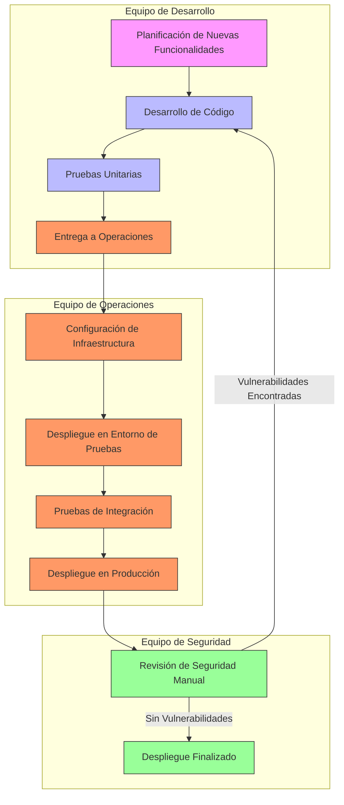

# Flujo de Trabajo Actual entre Equipos (Notación BPMN)

## Descripción del Flujo Actual

### 1. Planificación de Nuevas Funcionalidades
- **Actor**: Equipo de Desarrollo.
- **Descripción**: El equipo de desarrollo planifica las nuevas funcionalidades basándose en los requisitos del negocio.
- **Duración**: Variable (depende de la complejidad).
- **Puntos de Mejora**:
  - Falta de alineación con los equipos de operaciones y seguridad.
  - Planificación realizada en silos.

### 2. Desarrollo de Código
- **Actor**: Equipo de Desarrollo.
- **Descripción**: Desarrollo de las funcionalidades planificadas.
- **Herramientas**: IDEs (VS Code, IntelliJ), Git.
- **Puntos de Mejora**:
  - Falta de integración con herramientas de seguridad.
  - Código desarrollado sin considerar requisitos de infraestructura.

### 3. Pruebas Unitarias
- **Actor**: Equipo de Desarrollo.
- **Descripción**: Ejecución de pruebas unitarias para validar la funcionalidad del código.
- **Herramientas**: JUnit, pytest, Jest.
- **Puntos de Mejora**:
  - Baja cobertura de pruebas.
  - Pruebas unitarias no integradas con pruebas de seguridad.

### 4. Entrega a Operaciones
- **Actor**: Equipo de Desarrollo → Equipo de Operaciones.
- **Descripción**: El equipo de desarrollo entrega el código al equipo de operaciones para su despliegue.
- **Formato**: Repositorio de código (GitHub, GitLab).
- **Puntos de Mejora**:
  - Falta de notificación automática al equipo de operaciones.
  - Entrega sin documentación actualizada.

### 5. Configuración de Infraestructura
- **Actor**: Equipo de Operaciones.
- **Descripción**: Configuración de la infraestructura necesaria para desplegar el servicio.
- **Herramientas**: AWS CloudFormation, Terraform.
- **Puntos de Mejora**:
  - Configuración manual sin automatización.
  - Falta de coordinación con el equipo de desarrollo.

### 6. Despliegue en Entorno de Pruebas
- **Actor**: Equipo de Operaciones.
- **Descripción**: Despliegue del servicio en un entorno de pruebas para validación.
- **Herramientas**: AWS CodeDeploy, scripts personalizados.
- **Puntos de Mejora**:
  - Despliegue manual propenso a errores.
  - Falta de pruebas automatizadas de integración.

### 7. Pruebas de Integración
- **Actor**: Equipo de Operaciones.
- **Descripción**: Validación del servicio en el entorno de pruebas.
- **Herramientas**: Postman, Selenium.
- **Puntos de Mejora**:
  - Pruebas manuales sin automatización.
  - Falta de pruebas de seguridad.

### 8. Despliegue en Producción
- **Actor**: Equipo de Operaciones.
- **Descripción**: Despliegue del servicio en el entorno de producción.
- **Herramientas**: AWS CodeDeploy, scripts personalizados.
- **Puntos de Mejora**:
  - Despliegue manual sin automatización.
  - Falta de notificación al equipo de seguridad.

### 9. Revisión de Seguridad Manual
- **Actor**: Equipo de Seguridad.
- **Descripción**: Revisión manual del servicio desplegado para identificar vulnerabilidades.
- **Herramientas**: Herramientas de escaneo manual, checklist de seguridad.
- **Puntos de Mejora**:
  - Revisión realizada al final del ciclo (Shift-Right Security).
  - Vulnerabilidades detectadas tardíamente.

### 10. Despliegue Finalizado
- **Actor**: Equipo de Seguridad → Equipo de Desarrollo/Operaciones.
- **Descripción**: Si no se encuentran vulnerabilidades, el despliegue se considera finalizado.
- **Puntos de Mejora**:
  - Falta de feedback estructurado al equipo de desarrollo.
  - Proceso de despliegue no documentado.

## Identificación de Cuellos de Botella

### 1. Revisión de Seguridad Manual
- **Descripción**: La revisión manual de seguridad es un cuello de botella que retrasa el despliegue.
- **Impacto**: Aumenta el tiempo de entrega y genera frustración en los equipos.
- **Solución Propuesta**: Implementar herramientas de seguridad automatizadas en las primeras etapas del pipeline (Shift-Left Security).

### 2. Despliegues Manuales
- **Descripción**: Los despliegues manuales en entornos de pruebas y producción son propensos a errores.
- **Impacto**: Mayor probabilidad de fallos en producción y retrasos en los despliegues.
- **Solución Propuesta**: Automatizar los despliegues utilizando AWS CodePipeline y AWS CodeDeploy.

### 3. Falta de Métricas Compartidas
- **Descripción**: La ausencia de métricas compartidas dificulta la identificación de áreas de mejora.
- **Impacto**: Falta de visibilidad sobre el estado del proyecto y dificultad para priorizar tareas.
- **Solución Propuesta**: Definir métricas comunes para todos los equipos, como latencia de despliegue, cobertura de pruebas y tasa de fallos.

## Conclusión
El flujo de trabajo actual presenta varias oportunidades de mejora, especialmente en la comunicación entre equipos, la automatización de procesos y la integración de seguridad. La implementación de un pipeline de CI/CD con un enfoque en Shift-Left Security y la definición de métricas compartidas permitirán optimizar el flujo y reducir los retrasos y fallos en los despliegues.