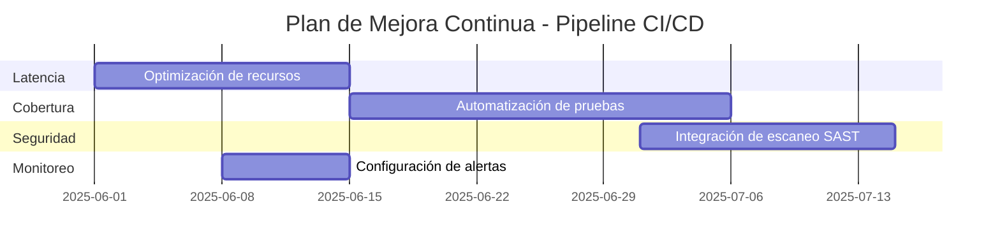

# Plan de Mejora Continua para Pipeline CI/CD en Entorno SOA

## Introducción
Este documento establece un plan de mejora continua para el pipeline CI/CD implementado en un entorno SOA. El plan se basa en la recopilación y análisis de métricas, feedback del equipo y la identificación de áreas de oportunidad. El objetivo es asegurar que el pipeline evolucione para cumplir con las propiedades operativas del reto: latencia de despliegue (<5 minutos), cobertura de pruebas automatizadas (>90%) y tasa de fallos post-implementación (<1%).

## Ciclo de Mejora Continua
El plan sigue el ciclo **PDCA (Plan-Do-Check-Act)**:

1. **Plan (Planificar):** Identificar oportunidades de mejora basadas en métricas y feedback.
2. **Do (Hacer):** Implementar cambios en el pipeline.
3. **Check (Verificar):** Evaluar el impacto de los cambios mediante métricas y feedback.
4. **Act (Actuar):** Establecer nuevas líneas base y repetir el ciclo.

---

## 1. Recopilación de Métricas y Feedback
### Métricas Clave
Las métricas se recopilan de los dashboards configurados en AWS CloudWatch (ver `dashboard-metricas.md`) y se analizan semanalmente.

| Métrica                     | Fuente de Datos               | Frecuencia de Análisis | Responsable       |
|-----------------------------|-------------------------------|------------------------|-------------------|
| Latencia de despliegue      | AWS CloudWatch                | Semanal                | Operaciones       |
| Cobertura de pruebas        | AWS CodeBuild + SonarQube     | Semanal                | Desarrollo        |
| Tasa de fallos post-despliegue | AWS CloudWatch              | Semanal                | Operaciones/DevOps|
| Vulnerabilidades críticas   | SonarQube/CodeGuru            | Semanal                | Seguridad         |
| Disponibilidad del servicio | AWS CloudWatch + X-Ray        | Diaria                 | Operaciones       |
| Tiempo de respuesta promedio | AWS X-Ray                    | Diaria                 | Operaciones       |

### Feedback del Equipo
- **Retrospectivas:** Reuniones quincenales con los equipos de desarrollo, operaciones y seguridad para discutir:
  - ¿Qué funcionó bien en el último ciclo?
  - ¿Qué se puede mejorar?
  - ¿Qué obstáculos enfrentaron?
- **Encuestas:** Encuestas mensuales para medir la satisfacción del equipo con el proceso de despliegue y las herramientas utilizadas.
- **Incidentes:** Análisis de incidentes post-mortem para identificar causas raíz y acciones preventivas.

---

## 2. Identificación de Oportunidades de Mejora
### Criterios para Priorizar Mejoras
Las oportunidades de mejora se priorizan según los siguientes criterios:
1. **Impacto en las propiedades operativas:** ¿La mejora contribuye a reducir la latencia, aumentar la cobertura o disminuir la tasa de fallos?
2. **Esfuerzo de implementación:** ¿Es una mejora rápida (low-hanging fruit) o requiere un esfuerzo significativo?
3. **Feedback del equipo:** ¿El equipo ha identificado esta área como un dolor recurrente?
4. **Riesgo:** ¿La mejora introduce nuevos riesgos o reduce riesgos existentes?

### Ejemplos de Oportunidades de Mejora
| Área de Mejora                  | Descripción                                                                                     | Prioridad | Responsable       |
|----------------------------------|-------------------------------------------------------------------------------------------------|-----------|-------------------|
| Automatización de pruebas       | Aumentar la cobertura de pruebas automatizadas para reducir fallos post-despliegue.            | Alta      | Desarrollo        |
| Optimización de recursos        | Reducir el uso de CPU/memoria en las etapas de compilación y pruebas para disminuir latencia.   | Media     | Operaciones       |
| Integración de seguridad        | Mejorar la detección de vulnerabilidades en etapas tempranas del pipeline (Shift-Left Security).| Alta      | Seguridad         |
| Monitoreo proactivo              | Implementar alertas tempranas para fallos en etapas críticas del pipeline.                     | Alta      | DevOps            |
| Documentación del pipeline      | Actualizar la documentación del pipeline para reflejar cambios y facilitar la incorporación de nuevos miembros. | Baja      | DevOps            |

---

## 3. Implementación de Mejoras
### Proceso de Implementación
1. **Propuesta:** El equipo responsable elabora una propuesta de mejora con:
   - Descripción de la mejora.
   - Beneficios esperados.
   - Métricas que se verán afectadas.
   - Esfuerzo estimado (horas/hombre).
   - Riesgos y mitigaciones.
2. **Aprobación:** La propuesta se discute en la retrospectiva quincenal y se aprueba según los criterios de priorización.
3. **Implementación:** El equipo responsable implementa la mejora en un entorno de prueba.
4. **Validación:** Se valida el impacto de la mejora en el entorno de prueba mediante métricas y feedback.
5. **Despliegue:** La mejora se despliega en el entorno de producción y se monitorea durante al menos una semana.

### Ejemplo: Automatización de Pruebas
**Propuesta:**
- **Descripción:** Implementar pruebas de integración automatizadas para servicios SOA críticos.
- **Beneficios:** Reducir la tasa de fallos post-despliegue al detectar problemas de integración antes del despliegue.
- **Métricas afectadas:** Cobertura de pruebas (>90%), tasa de fallos post-despliegue (<1%).
- **Esfuerzo:** 40 horas (2 semanas).
- **Riesgos:** Posible aumento en el tiempo de ejecución del pipeline.
- **Mitigación:** Ejecutar pruebas de integración en paralelo con pruebas unitarias.

**Implementación:**
1. Seleccionar herramientas de pruebas de integración (ej: Postman, SoapUI, Karate).
2. Escribir pruebas para los servicios SOA críticos.
3. Integrar las pruebas en el pipeline de CI/CD (etapa de pruebas).
4. Validar en entorno de prueba y ajustar umbrales de cobertura.

**Validación:**
- Verificar que la cobertura de pruebas aumenta al menos un 5%.
- Confirmar que la tasa de fallos post-despliegue disminuye.

---

## 4. Evaluación de Impacto
### Métricas de Éxito
Las mejoras implementadas se evalúan según su impacto en las métricas clave:

| Métrica                     | Objetivo Inicial | Objetivo Post-Mejora | Responsable       |
|-----------------------------|------------------|----------------------|-------------------|
| Latencia de despliegue      | <5 min           | <4 min               | Operaciones       |
| Cobertura de pruebas        | >90%             | >95%                 | Desarrollo        |
| Tasa de fallos post-despliegue | <1%            | <0.5%                | Operaciones/DevOps|

### Retrospectivas de Mejora
- **Frecuencia:** Quincenal.
- **Participantes:** Representantes de desarrollo, operaciones, seguridad y DevOps.
- **Temas a discutir:**
  - ¿Se cumplieron los objetivos de las mejoras implementadas?
  - ¿Qué métricas mejoraron y cuáles no?
  - ¿Qué nuevos obstáculos surgieron?
  - ¿Qué mejoras adicionales se pueden implementar?

### Ejemplo de Retrospectiva
**Tema:** Automatización de pruebas de integración.
**Discusión:**
- **Logros:** La cobertura de pruebas aumentó del 92% al 96%, y la tasa de fallos post-despliegue disminuyó del 0.8% al 0.3%.
- **Obstáculos:** El tiempo de ejecución del pipeline aumentó en un 15% debido a las pruebas de integración.
- **Acciones:** Optimizar las pruebas para ejecutarse en paralelo y reducir el tiempo de ejecución.

---

## 5. Plan de Acción a 3 Meses
### Objetivos
| Objetivo                          | Métrica Asociada               | Responsable       | Plazo   |
|-----------------------------------|--------------------------------|-------------------|---------|
| Reducir latencia de despliegue    | <4 minutos                    | Operaciones       | 1 mes   |
| Aumentar cobertura de pruebas    | >95%                         | Desarrollo        | 2 meses |
| Reducir tasa de fallos post-despliegue | <0.5%                 | DevOps            | 3 meses |
| Implementar monitoreo proactivo  | Alertas tempranas configuradas | DevOps            | 1 mes   |
| Mejorar integración de seguridad | Vulnerabilidades críticas = 0  | Seguridad         | 2 meses |

### Cronograma de Implementación

---

## 6. Herramientas de Soporte
| Herramienta               | Propósito                                                                                     |
|---------------------------|---------------------------------------------------------------------------------------------|
| AWS CloudWatch            | Monitoreo de métricas y configuración de dashboards.                                        |
| SonarQube                 | Análisis de calidad de código y detección de vulnerabilidades.                              |
| AWS CodeGuru              | Revisión automatizada de código y recomendaciones de seguridad.                             |
| Jira                      | Seguimiento de mejoras y gestión de tareas.                                                 |
| Confluence                | Documentación del pipeline y retrospectivas.                                                |
| Slack                     | Comunicación en tiempo real y notificaciones de alertas.                                    |

---

## 7. Roles y Responsabilidades
| Rol               | Responsabilidades                                                                                     |
|-------------------|-------------------------------------------------------------------------------------------------|
| **DevOps**        | - Mantener y mejorar la configuración del pipeline CI/CD.
- Configurar y monitorear dashboards y alarmas.
- Implementar mejoras en el pipeline.
- Coordinar retrospectivas y seguimiento de métricas. |
| **Desarrollo**    | - Escribir y mantener pruebas automatizadas.
- Corregir fallos identificados en las métricas.
- Participar en retrospectivas y proponer mejoras. |
| **Operaciones**   | - Monitorear métricas operativas (latencia, disponibilidad).
- Optimizar el uso de recursos en el pipeline.
- Investigar y resolver incidentes post-despliegue. |
| **Seguridad**     | - Monitorear métricas de seguridad y resolver vulnerabilidades.
- Integrar herramientas de seguridad en el pipeline.
- Participar en retrospectivas y proponer mejoras. |

---

## 8. Comunicación y Transparencia
- **Dashboards públicos:** Los dashboards de métricas estarán disponibles para todos los equipos en AWS CloudWatch.
- **Reuniones semanales:** Reuniones breves (15 minutos) para revisar métricas y alertas.
- **Reporte mensual:** Documento con el resumen de métricas, mejoras implementadas y próximos pasos.
- **Canal de Slack:** Canal dedicado (`#soa-cicd-metrics`) para notificaciones de alertas y discusiones.

---

## 9. Riesgos y Mitigaciones
| Riesgo                                  | Impacto                                      | Mitigación                                                                                     |
|-----------------------------------------|----------------------------------------------|-------------------------------------------------------------------------------------------------|
| Resistencia al cambio por parte del equipo | Baja adopción de mejoras                    | Involucrar al equipo en la identificación de mejoras y demostrar beneficios tangibles.       |
| Aumento en la complejidad del pipeline  | Mayor dificultad para mantener el pipeline   | Documentar cambios y proporcionar capacitación al equipo.                                    |
| Falta de métricas confiables            | Decisiones basadas en datos incorrectos      | Validar fuentes de datos y configurar alarmas para detectar inconsistencias.                 |
| Retrasos en la implementación de mejoras | Objetivos no cumplidos                      | Priorizar mejoras de bajo esfuerzo y alto impacto (low-hanging fruit).                       |

---

## 10. Conclusión
El plan de mejora continua es un componente esencial para asegurar que el pipeline CI/CD en un entorno SOA evolucione y se adapte a las necesidades cambiantes del negocio y los equipos. Al seguir el ciclo PDCA y basar las decisiones en métricas y feedback, se garantiza que las mejoras implementadas tengan un impacto positivo medible en las propiedades operativas del reto.

**Próximos pasos:**
1. Configurar los dashboards en AWS CloudWatch (ver `dashboard-metricas.md`).
2. Realizar la primera retrospectiva quincenal para identificar oportunidades de mejora.
3. Implementar la primera mejora priorizada (ej: automatización de pruebas).
4. Monitorear el impacto y ajustar el plan según sea necesario.